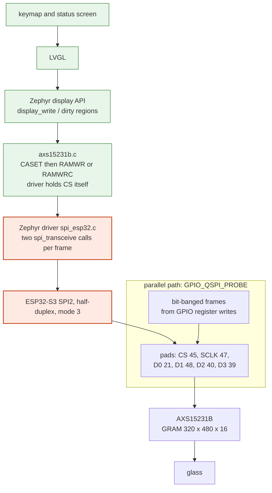
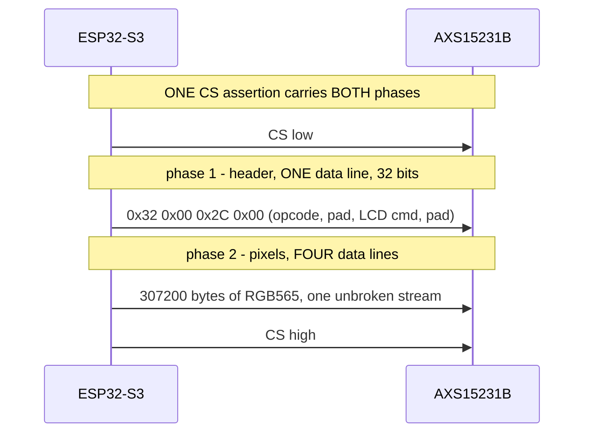
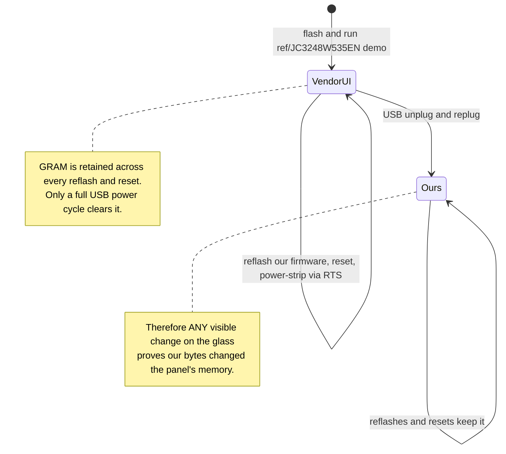
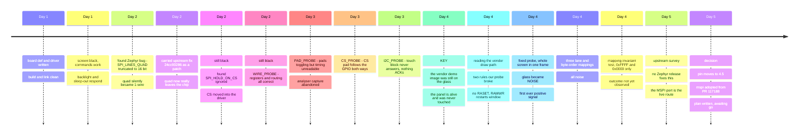
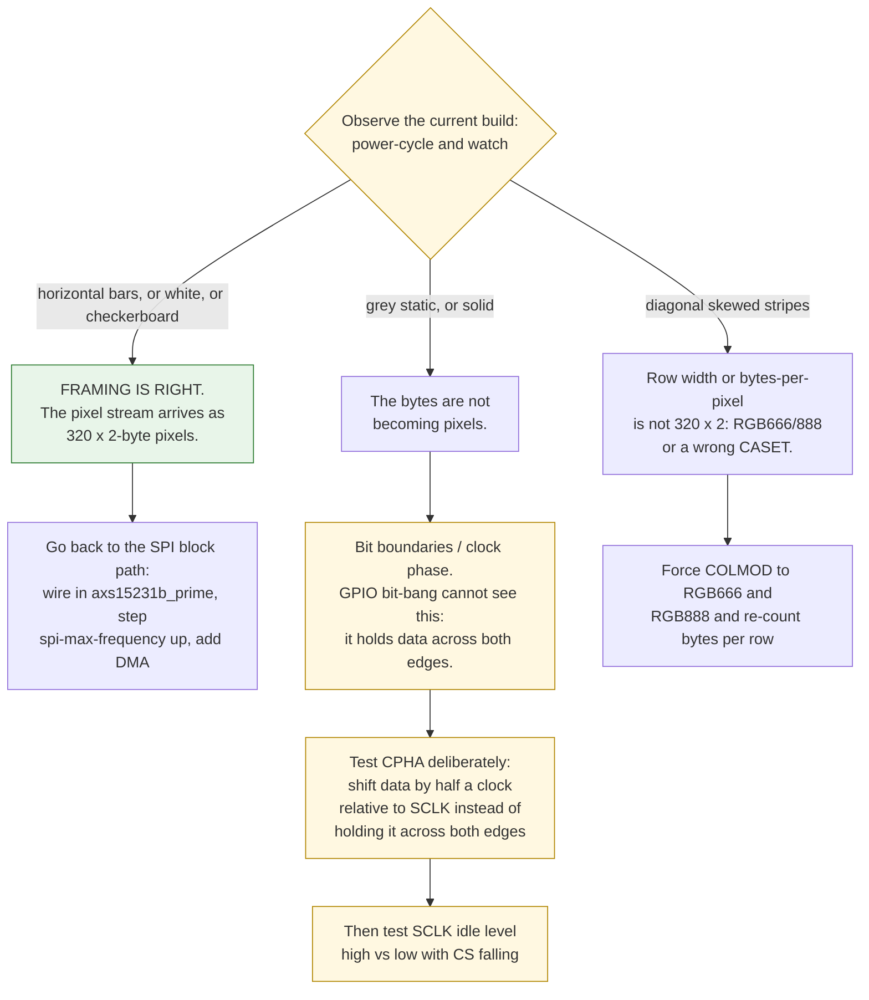
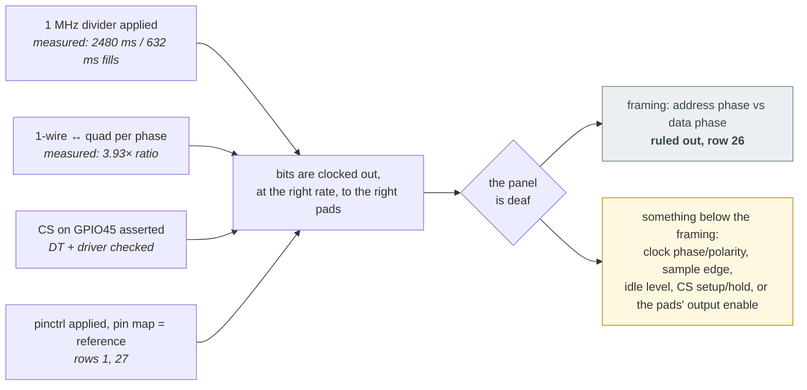
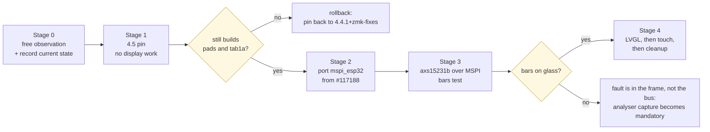

# AXS15231B on Coban Tab 1a — bring-up findings, dead ends, and what to do next

**Status:** the panel is *not* working. Display bring-up is blocked on one unknown.
**Direction decided 2026-11-18:** upgrade the Zephyr pin to **4.5**, and adopt the ESP32 **MSPI** controller from
PR #117188 instead of continuing to fight `spi_esp32_spim.c`. Plan with gates and rollbacks in
[§13](#13-plan-zephyr-45-upgrade--mspi-adoption) — **not implemented yet, awaiting confirmation.**
**Hardware:** Coban Tab 1a — ESP32‑S3 + JC3248W535EN module (AXS15231B controller, 320×480, QSPI, RGB565, capacitive touch on I²C).
**Written:** 2026-11-18, after ~4 days of hardware bring-up. Supersedes the notes scattered through `axs15231b.c` comments.
**Repos:** all work is **uncommitted** in `zmk/` and `zmk-config/` (see [State of the tree](#state-of-the-tree)).

> **TL;DR** — The vendor's own ESP-IDF demo paints a picture on this exact board and unit. Our firmware does not.
> Commands reach the controller (backlight, sleep-out, display-on/off are visible). Pixel data has never been
> turned into pixels by anything we built. The single strongest result so far: a hand-built QSPI pixel stream
> from GPIO **replaced the vendor demo's frozen image with noise** — the first time our firmware ever changed
> the panel's memory. Everything is now narrowed to one of: (a) Zephyr's ESP32 SPI block mis-renders quad
> transfers, or (b) the clock phase / bit-boundary conventions differ between us and the panel.

---

## 1. What "working" means

| Phase | Deliverable | State |
| --- | --- | --- |
| A | Panel initialises over QSPI, LVGL status screen (clock/calendar) visible | **blocked — this document is about this** |
| B | Backlight PWM (LEDC ch0 → GPIO1) on/off + idle blanking | works, verified visually |
| C | Touch over I²C 0x3B (SDA GPIO4, SCL GPIO8, 400 kHz) | not started; bus is silent, see [side issues](#7-side-issues-that-are-not-the-display) |
| D | RAM/PSRAM budget, FPS, current draw recorded in `esp-port/test-results/` | not started |

The whole screen pipeline downstream of the display driver is known-good: ZMK's shell + LVGL render fine on
other targets, and the driver compiles, links, and reports `AXS15231B initialized (320x480)` at ~0.53 s
in every boot log.

---

## 2. The system, and where the fault boundary is



**What is proven good:** everything above `SPI` in that picture, plus the pads and their routing, plus the
controller's power, GRAM and glass. **What is suspect:** the ESP32 SPI peripheral's quad rendering, and the
clock-phase convention at the pad.

The `GPIO_QSPI_PROBE` path exists precisely to bypass the suspect region: it drives the same six pads with
hand-written register writes and hand-built edges, so any difference in outcome can only belong to the SPI block.

---

## 3. The wire protocol (as verified, not as assumed)

Ground truth is the vendor driver `ref/JC3248W535EN/src/esp_lcd_axs15231b.c` plus ESP-IDF's
`esp_lcd_panel_io_spi.c`. Three rules of this panel in QSPI mode, each of which cost us a debugging day:



1. **The header is 32 bits on one line, the pixels are 4-wire.** `AXS15231B_PANEL_IO_QSPI_CONFIG` sets
   `quad_mode = true` and `lcd_cmd_bits = 32`; in IDF's `esp_lcd_panel_io_spi.c`, `quad_mode` sets
   `SPI_TRANS_MODE_QIO` **only on the color transfer** — the command/param transfers stay single-line
   (only `octal_mode` makes the command multiline). Opcode `0x02` = command+params on D0, `0x32` = pixels on
   four lines. Header byte order is `[opcode, 0x00, cmd, 0x00]` — confirmed twice, against IDF's
   `spi_lcd_prepare_cmd_buffer()` byte reversal and against the vendor's `(opcode << 24) | (cmd << 8)`.
2. **RASET is never sent in QSPI mode.** The vendor guards it: `if (0 == flags.use_qspi_interface)`. The panel
   takes its rows from the write command plus the number of pixels streamed. Our first driver sent RASET.
3. **`RAMWR` (0x2C) restarts the window; `RAMWRC` (0x3C) continues it.** The vendor picks by
   `if (y_start == 0) RAMWR else RAMWRC`. Consequence: a fill chopped into several frames, each issuing its
   own `RAMWR` under its own CS, **repaints the same first pixels forever** and never reaches the rest of the
   screen. Our earlier GPIO probe did exactly this, so its "nothing happened" result was worthless.

The panel wants **SPI mode 3** (`spi_mode = 3`, CPOL=1/CPHA=1, SCLK idles high) at **40 MHz**
(`.pclk_hz = 40 * 1000 * 1000`), with **DMA** (`SPI_DMA_CH_AUTO`) and `trans_queue_depth = 10`.
ESPHome drives this same controller family at `data_rate: 40MHz`.

**Our configuration today:** `spi-max-frequency = <1000000>`, half-duplex, no bus-level `cs-gpios` (CS moved
into the panel driver because Zephyr's ESP32 driver ignores `SPI_HOLD_ON_CS`), **no DMA** (`&spi2` has no
`dmas` property, so the driver's DMA path is unavailable and transfers are polled).

---

## 4. The single most useful property of this hardware



The panel retains its GRAM across reflashing and resets. So the vendor demo's LVGL image sits frozen on the
glass while our firmware runs, and we can tell with certainty whether our firmware touched the panel memory
at all. Every observation in this document rests on that, and every observation has to come from a human
looking at the glass — which is a large part of why this took so long.

---

## 5. Investigation timeline



---

## 6. Evidence ledger

Read this before designing any new experiment. Each row is a hypothesis that has already been paid for.

| # | Hypothesis / question | Method | Result | Verdict |
| --- | --- | --- | --- | --- |
| 1 | Wrong pin map | compared `ref/JC3248W535EN/src/esp_bsp.h` with our overlay | CS 45, PCLK 47, D0 21, D1 48, D2 40, D3 39, BL 1, RST **NC**, TE 38, SDA 4, SCL 8 | ruled out |
| 2 | Signals not routed out of the SPI block | `WIRE_PROBE`: read `uart_cam`/`spi_cam` pin-swap regs and the GPIO-matrix signal routing | all six pads carry the right peripheral signals | ruled out |
| 3 | Zephyr never really goes quad | registers + logic capture on the pads | **confirmed bug**: `spi_esp32_get_line_mode()` takes `uint16_t`, so `SPI_LINES_QUAD` (bit 16+) truncates to 0 → always 1-wire | **fixed**, carried as patch |
| 4 | CS raised between header and pixels | read `esp_lcd_panel_io_spi.c` (`SPI_TRANS_CS_KEEP_ACTIVE`) vs Zephyr | Zephyr's ESP32 driver never reads `SPI_HOLD_ON_CS` | **fixed**, CS driven by the panel driver, `AXS_NO_HW_CS_SLAVE 3` |
| 5 | Init table wrong | byte-compared our table against `esp_bsp.c lcd_init_cmds` | identical | ruled out |
| 6 | Header byte order wrong | read IDF `spi_lcd_prepare_cmd_buffer()` and vendor `tx_param()` | `02 00 cmd 00` is right | ruled out |
| 7 | Command phase must be 4-wire | read IDF `tx_param()`: multiline is set for `octal_mode` only | commands really are 1-wire | ruled out |
| 8 | Missing SWRESET, or wrong reset wiring | vendor `panel_axs15231b_reset()`; vendor RST is NC | SWRESET + 120 ms present, no reset line exists | ruled out |
| 9 | CS pad not actually moving | `CS_PROBE`: drive GPIO13 of `gpio1`, sample the pad | pad follows both directions | ruled out |
| 10 | Data pads not actually moving | `PAD_PROBE`, then `GPIO_QSPI_PROBE` pad self-check | drive high/low and read back from the pad register: `ok ok` on all six pads | ruled out |
| 11 | Clock not reaching the pin | sample SCLK from the pad while a hand clock runs | 96 samples, 12 transitions = the 25 kHz test clock | ruled out |
| 12 | Clock divider too slow / too fast | computed S3 half-duplex divider: `pre` ≤ 16 × `n` ≤ 64 | slowest reachable SCLK ≈ 78 kHz, so a requested "8 kHz" **never existed**; ~2 µs sampling jitter cannot resolve an 8–13 µs bit | analyser route abandoned |
| 13 | Pad conflicts (kscan, JTAG, flash) | checked every user of the six pads | kscan uses GPIO2/5 | ruled out |
| 14 | Panel dead / glass dead / GRAM dead | flashed `ref/JC3248W535EN` demo with `./flash.sh jc3248` | **LVGL UI appears and works**; log shows `send init commands success` | ruled out — **positive control** |
| 15 | Our firmware never reached GRAM | the demo image was still frozen on the glass after our runs | true for every build until the fixed probe | ruled out |
| 16 | Hand-built quad frames reach GRAM | fixed probe: one frame, one CS assertion, no RASET, 307200 B | **the glass changed** from the vendor UI to noise | **first positive result** |
| 17 | Wrong lane order / wrong intra-pixel bit order | three fills: D0=first bit, D0=last bit, D0=last bit + bytes exchanged | all three: noise | none of these mappings, inconclusive as a set (see §9) |
| 18 | Framing: does the stream decode as 320 × 2-byte pixels | three fills of `0xFFFF`/`0x0000` only (invariant to every intra-pixel permutation): white → checkerboard → 4-row bars | build flashed and ran (log confirms all three fills, ~0.56 s each); **the glass was never observed** | **OPEN — this is where we are** |
| 19 | I²C touch dead indicates the chip is half-dead | `I2C_PROBE`: bus clocks, address scan 0x08–0x77 | nothing ACKs | separate issue; vendor demo logs no touch errors either — the touch node in that demo is I²C at 0x3B and is also not proven |
| 20 | The whole bring-up read as a dead screen because the backlight was never on | read the callers: `axs15231b_blanking_off()` is the only thing that enables the backlight, and ZMK calls it from `zmk_display_init()`, a later POST_KERNEL step than the blocking fill test — which runs on the init thread, so the panel only lights after the instrument has finished | both bring-up instruments now enable the backlight themselves | that run proved nothing; a dark panel with an unlit backlight is indistinguishable from a dead one |
| 21 | Anything at all reaches the panel over MSPI | first run with the backlight on: colour noise (row 16's stale GRAM) fades to black over ~10 s, and nothing else visibly happens | **cannot be read**: that build sent DISPLAY_OFF as its first command, and a panel with its output switched off and a panel whose GRAM is all black are the same black screen — so "black, no reaction" is two different faults wearing one face | open; the instrument no longer sends DISPLAY_OFF and ends on DISPLAY_INVERSION, which turns an all-black frame white and is the only thing that separates the two |
| 22 | The MSPI device runs at the rate the node asks for, and the per-phase line width really changes | timing every full-panel fill: 2457600 bits ÷ (clock × data lines) | 1-wire 2480–2498 ms vs 2457.6 ms theory; quad 629–637 ms vs 614.4 ms theory — a 3.93× ratio | **confirmed** at 1 MHz. The clock divider and the I/O-mode switch are both live; this is the check that must be re-run at every clock step up to 40 MHz |
| 24 | The fill test's "painted" line means pixels went out | same timing check | a build where all six patterns "succeeded" in 10 ms: `paint_hold`, whose job is to keep LVGL off the glass, sat inside `axs15231b_write_wide()` — which is also the fill test's own entry point — so every pattern returned instantly having sent nothing | caught by timing only. The hold now guards the display API (`axs15231b_write`) and not the write path, and the fill log carries the elapsed ms so this cannot hide again |
| 25 | The instrument is limited by having to be watched in a specific 35 s window | moved the fills and the command probe off the init thread onto a dedicated looping thread (`axs_bringup`), with LVGL still held off by `paint_hold` | the panel now replays the whole sequence every ~35 s for as long as the board is powered | done. Removes the timing coordination that made every observation in this ledger expensive |
| 26 | The frame header is in the wrong **phase**: we send it as the MSPI address phase, the reference sends it as an ordinary 1-wire data phase | rewrote `axs15231b_mspi_frame()` to frame exactly as `esp_lcd_panel_io_spi` does — header `[opcode][0x00][cmd][0x00]` as a data phase in a first transfer with `hold_ce`, pixels as a second transfer, no address phase anywhere — which is also how the SPI path in this same file frames it | still nothing at all: no fills, no MADCTL rotation, no inversion, on a lit panel, over several cycles | **ruled out.** Both framings are deaf on MSPI, while the same framing on the SPI path is the build where `DISPLAY_OFF` visibly blanked the panel (row 21's precedent, recorded in `cobantab1a.conf`). The fault is below the framing |
| 27 | CS on GPIO45 may never be asserted on the MSPI path (`ce_set()` does nothing at all, and logs nothing, if `num_ce_gpios == 0`) | read the built devicetree and the driver: `ce-gpios = <&gpio1 13>` (= GPIO45, active-low, pull-up) is present, `num_ce_gpios` is built from it, and the driver configures each CE `GPIO_OUTPUT_INACTIVE` at init | CS is real and is being driven | ruled out, together with pinctrl (the driver applies `pinctrl-0` at init) and the pin map (row 1) |
| 28 | The init table differs from the vendor's after all | scripted parse of both tables and a byte-for-byte compare of every command's parameter list | all entries identical, including the two `0xA4` and two `0xBB` repeats and the trailing `0x13`/`0x11`/`0x2C`; the only "diffs" were the parser's own artifacts where our table uses `NULL` and named delays | **ruled out again**, independently of row 5, and now reproducible rather than eyeballed |
| 29 | The bit-bang probe's noise result (rows 16, 17) means anything about lanes or framing | read the probe's own sequence against the datasheet: it sent SWRESET, SLPOUT, COLMOD, CASET, DISPON — **never the 32-entry vendor table** — and SWRESET returns every register to its default (datasheet V0.4 §3.2.1/§4.2.2) | the panel was left with default boost, gate, source and gamma settings, so it would have shown garbage on any bus, ours or the vendor's | **withdrawn.** Row 16 is the only fact left (the glass can be changed by hand-built frames); row 17's "none of these mappings" is void, and the probe now replays the whole table (§15) |
| 30 | The instruments are the only thing that commands the panel during a run | read the callers of `blanking_on`/`blanking_off`: ZMK's display init calls `display_blanking_off()` a POST_KERNEL step after the driver's init, and both of our blanking hooks send panel commands (`SLPOUT`+`DISPON`, `DISPOFF`+`SLPIN`) | every instrument run so far silently received two commands it did not log, right after the sequence it was being tested on — and those two are exactly the pair that can blank a panel | **now held off** while an instrument owns the panel (`paint_hold` also gates the blanking hooks), so the log is the whole conversation. Unproven as a *cause* of anything; it was a hole in the method |
| 31 | `mspi_esp32.c` re-aligns SCLK before every CS assertion, as ESP-IDF does | read `update_transfer_config()`: it returns early unless `dev_hw_dirty`, and `dev_config_apply()` sets that flag for CPP/endian/frequency but **not** for `MSPI_DEVICE_CONFIG_IO_MODE`, which is the one this driver changes per frame | the mode-3 "one dummy byte with CE released" realign therefore runs once — on the first transfer (SWRESET) — and never again, across every later 1-wire↔quad switch | **suspect, not yet tested.** One-line fix (`dev_hw_dirty` on IO_MODE) is ready; deliberately not applied blind, because row 26 shows both framings deaf and this would be a third guess in the same dark |
| 32 | "Just re-run the instrument on the SPI path" (§9, §14) is one flash away | `grep CONFIG_SPI build/cobantab1a/zephyr/.config`, then actually built it | not set — `CONFIG_SPI` and `CONFIG_SPI_EXTENDED_MODES` are both absent — **and** with the panel under `&spi2` Kconfig refuses the configuration outright: `AXS15231B select SPI` while depending on `SPI_EXTENDED_MODES`, which depends on `SPI`, is a dependency loop | the experiment was not one flash away, it was not *buildable*; both fixed now — `select SPI` → `depends on SPI` for the SPI-bus case, and `esp-port/bringup/spi-path.{conf,overlay}` builds clean (verified in the generated `zephyr.dts`) |
| 33 | The panel can only be observed by a person looking at the glass | datasheet V0.4 §5.3.2.2 "Read Sequence" + the command table (p. 23): `RDDID 04h`, `RDDPM 0Ah`, `RDDMADCTL 0Bh`, `RDDIPF 0Ch`, `RDID1 DAh` are readable on SPI/QSPI, and `RAMRD 2Eh`/`RAMRDC 3Eh` read GRAM back | a bit-banged read is possible with the pads already in this tree; §4.2.2.22 warns non-MIPI interfaces return only `par0`, and §4.2.2.35's own table header says the pixel format **defaults to 16 bits/pixel**, so the "maybe it wants 24-bit after reset" worry is weak | **new capability, built** (`AXS15231B_QSPI_READBACK`, §15). The read opcode is disputed — `03h` in the datasheet's figures, `0x0B` in the vendor driver's unused `LCD_OPCODE_READ_CMD` — so the probe tries both, with and without a dummy phase, and the decisive signal is a register that *changes* when its own write command is sent between two reads |

### Fixed bugs, for the record

| Bug | Where | Fix |
| --- | --- | --- |
| `SPI_LINES_QUAD` silently downgraded to 1-wire | `zephyr/drivers/spi/spi_esp32.c` (`spi_esp32_get_line_mode()` parameter is `uint16_t`) | upstream `24cc93286`, carried in `zmk/esp-port/patches/0001-*.patch`, re-applied by `esp-port/apply-zephyr-patches.sh` from `setup-dev.sh` and `build_cobantab1a.sh`; idempotent, fails loudly on drift. Drop it when the Zephyr pin (v4.4.1+zmk-fixes) includes it. |
| `SPI_HOLD_ON_CS` ignored, CS raised mid-frame | `zephyr/drivers/spi/spi_esp32.c` | workaround in our driver: no `cs-gpios` on `&spi2`, `cs-gpios` on the `axs15231b` node, driver brackets both phases itself. Side effect: compiles out upstream's mode-3 "dummy transaction to sync CLK and software CS" workaround, which is why `axs15231b_prime()` exists. |

---

## 7. Side issues that are *not* the display

Do not chase these as causes of the black screen — they are independent. But they do affect any long test run.

- `flash_esp32: Flash write error: 261` (= `ESP_ERR_NOT_FOUND`) writing `storage` at `0xfb0000`, then
  `settings_subsys_init failed (err -5)`. Needs a partition-table / flash-size check.
- BLE controller assert `hci_core.c:482` at ~13.5 s **halts the board**, which is why
  `CONFIG_ZMK_BLE=n` is set temporarily. Long probe sequences were being cut off by this.
- `CONFIG_SYS_CLOCK_TICKS_PER_SEC=250000` is temporary (bring-up timer resolution) and must go back.
- Two older builds with `CONFIG_AXS15231B_PIXELS_1WIRE=y` produced **zero console bytes**. Unexplained,
  never investigated. Do not conclude anything from a build with that option on.
- Homebrew CMake 4 must not be used (rejects `cmake_minimum_required < 3.5`, e.g. `libmetal`);
  the pip wheel in `zmk/.venv` and `~/.local/bin` shims exist for this — see `zmk/esp-port/toolchain-esp32.md`.

---

## 8. What is running right now

`CONFIG_AXS15231B_GPIO_QSPI_PROBE=y` is the live probe; `COLOR_TEST`, `COMMAND_PROBE`, `QSPI_TOUCH_PROBE`,
`WIRE_PROBE`, `PAD_PROBE`, `I2C_PROBE`, `CS_PROBE` are all off. On boot the probe:

1. takes the six pads from SPI2 by direct register write (bank-aware `out1_*`/`enable1_*`/`in1` for pads ≥ 32,
   which is five of the six), enables input on each;
2. self-checks: drives every pad high then low and reads it back from the pad register, then samples SCLK from
   the pad while its own clock runs — this is what makes the rest of the run trustworthy;
3. sends `SWRESET` → `SLPOUT` → `COLMOD 0x55` → `CASET 0..319` → `DISPON`, all 1-wire, **no RASET**;
4. paints three full screens, one unbroken frame and one CS assertion each, ~0.56 s apiece (~550 kB/s), ~2.5 s
   apart: `0xFFFF` white → pixel-on/off checkerboard → 4-row light/dark bars.

Expected if framing is right: solid white, then grey checkerboard, then **horizontal 4-row bars, left on the
glass**. Power-cycling (USB unplug/replug) replays the whole sequence.

**The result of that run has not been observed.** That is the immediate next action — see §9.

One known code-hygiene wart from the last edit: the explanatory comment block for step 4 is stranded inside
`axs15231b_gpio_qspi_probe()` at the wrong indent level, and the function's header comment still describes the
older red/green/blue fills. Cosmetic only.

---

## 9. The two remaining hypotheses, and the experiments that tell them apart



### Ranked next experiments

1. **Look at the glass.** Free, and it splits the search space in half. (`./flash.sh tab1a` has already run;
   power-cycle to replay. Ask the user, or add it to the log script as a timed prompt.)
2. **Get a logic analyser that actually decodes.** Every failure so far was a *measurement* problem, not a
   reasoning problem. The earlier capture attempt failed because it sampled a 25 kHz-ish signal at ~2 µs
   jitter and tried to read intervals by hand — not because capture is useless. An 8-channel analyser at
   ≥ 24 MHz on CS/SCLK/D0–D3, with a SPI decoder attached, captures **the vendor demo's frames and our
   frames on the same board** and shows the difference directly: idle level of SCLK, which edge latches data,
   where the bit boundary falls after CS falls, and how many bits per pixel. One capture would replace about
   two days of the work recorded in §6. **This is the highest-value thing a human can do here.**
3. **Bisect from the working side, not the broken side.** The vendor demo is a known-good firmware on the same
   silicon. Modify it to do the *minimum* that could fail — replace its pixel fill with a solid colour, then
   replace its `esp_lcd_panel_io_spi` calls with raw `spi_master` half-duplex quad transfers configured the
   way Zephyr configures them. Each step that still paints eliminates a whole layer.
4. **The MSPI route** — see the next subsection for the port list. Zephyr issue
   [`#102333`](https://github.com/zephyrproject-rtos/zephyr/issues/102333) is the live thread (28 comments, still
   active as of 2026-11-16): every community port of an ESP32‑S3 QSPI LCD goes through the MSPI controller,
   because `spi_esp32_spim.c` was never built for quad LCD writes. The one comment that sums it up, from someone
   who got a 466×466 QSPI AMOLED running on upstream `chipone,co5300` + downstream MSPI: *"the CO5300 SPI backend
   is single-line. Quad writes require MSPI."*

### The instrument as it now stands (2026-11-19)

The MSPI path is up and painted at 1 MHz with no errors, so the remaining questions are all questions about
the glass. Two instruments run inline on the init thread, in this order, because a work-queue item would land
in the middle of a multi-second frame write:

1. **Fill test** — the three mapping-invariant patterns (all on, pixel checkerboard, 4-row bars) painted
   twice: pixels on one data line, then on the bus's wide phase. One flash therefore answers both
   "does anything reach GRAM" and "is the fault specific to the quad phase", which are indistinguishable in
   the log.
2. **Command probe** — MADCTL with the scan axes swapped and restored, then DISPLAY_INVERSION on and off,
   twice through, acting on the frame the fills just painted.

DISPLAY_OFF/ON is deliberately *out* of the probe. It was the first command in an earlier run, and it made
the run unreadable: once the output has been switched off, an all-black frame and a dead output are the same
black screen, so no later observation can be interpreted. Inversion is the discriminator that replaces it —
black turning white is something only a panel with its output on can do.

| What the glass does | Verdict |
| --- | --- |
| bars rotate 90° and back | frame **and** commands both landed; the remaining problem is colour/byte order only |
| screen stays black, inversion turns it **white** | output is on, pixels are arriving as zeros — suspect the DMA data phase |
| screen stays black, inversion does nothing | the output is off, or no command of ours has ever been understood |
| 1-wire fills paint, wide fills do not | framing, geometry and commands are cleared; only the quad data phase is left |
| nothing changes at all from power-on | nothing reaches the panel; the stale noise of row 16 is the whole picture |

**Result of running it (2026-11-19): the last row.** Across several full cycles, on a lit panel, at 1 MHz, the
glass never changes once — no fills on one line or four, no 90° rotation, no inversion flip. Whatever was in
GRAM before this firmware existed is still there, and no command or pixel of ours has ever been understood
over MSPI.

### What is left, and the one flash that settles it

Everything measurable in software is now known good, and none of it explains the glass:



The comparison that has to drive the next move is not us-vs-reference, it is **us-vs-us**: the same driver,
the same pads, the same panel, on `&spi2` through Zephyr's SPI driver, is the build where `DISPLAY_OFF` made
the panel go dark. So:

1. **Flip the overlay back to the SPI path and re-run this same instrument.** One flash, and it splits "the
   ported MSPI controller does not produce a usable waveform" from "the panel, the wiring or the pads are
   dead". Both bus paths are already implemented and building in `axs15231b.c` — it is a compatible change in
   `cobantab1a.overlay`, not new code. If the SPI path paints the bars, the product is unblocked and MSPI
   becomes an optimisation to fix later; the quad line-mode truncation that used to cripple that path is
   fixed in the v4.5.0 pin, so it now has real quad pixel writes too.
2. **Logic analyser** — unchanged as the highest-value *measurement*: 8 channels at ≥ 24 MHz on CS/SCLK/D0–D3,
   capturing `./flash.sh jc3248` and our firmware back to back on the same board. Once framing is eliminated
   it is the only thing that can see clock phase, sample edge, CS setup/hold and idle levels.
3. **Bisect from the working side** — take the vendor demo and strip it toward ours one layer at a time
   (solid fill, then raw `spi_master` quad transfers configured the way Zephyr configures them).

### The chosen route: adopt the MSPI driver from PR #117188 (step-by-step in §13)

This is now the decided path. The analysis below is why, and §13 is the plan.

This is the path with the highest expected value, and **it does not require a Zephyr upgrade** — see the next
subsection. Our pinned v4.4.1 already has the MSPI *subsystem* (`zephyr/drivers/mspi/` with ambiq, dw and stm32
backends, and `dts/bindings/mspi/`); what is missing is only the ESP32 *backend*.

Copy from [`PR #117188`](https://github.com/zephyrproject-rtos/zephyr/pull/117188) (open, unmerged, last activity
2026-11-16), 6 files:

```
drivers/mspi/mspi_esp32.c                        +1559
drivers/mspi/mspi_esp32.h                          +90
drivers/mspi/Kconfig.esp32                          +54
drivers/mspi/Kconfig                                 +1
drivers/mspi/CMakeLists.txt                          +1
dts/bindings/mspi/espressif,esp32-mspi.yaml         +84
```

It **cannot be taken as-is**. The thread documents what is wrong with it and who fixed what:

| Take from | Why it is needed |
| --- | --- |
| **#121107** `drivers: mspi: esp32: fix status and devicetree integration` (open, updated 2026-11-18) | an MSPI-only build omits the SPI HAL sources → unresolved `spi_hal_*`; optional `dma-host` / polling-IRQ DT properties are read unconditionally. |
| **[`zephyrproject-rtos/hal_espressif#670`](https://github.com/zephyrproject-rtos/hal_espressif/pull/670)** | fixes that HAL source selection. We already fetch `hal_espressif` blobs, so this is a patch to a vendored module. |
| walidbadar's branch `mspi_esp32_review` @ `d715fdcbbac` | `get_channel_status()` (a mandatory op) and `MSPI_DEVICE_CONFIG_ALL` support, which the in-tree MSPI device drivers require; plus Kconfig correctness — `MSPI_ESP32_PSRAM_DMA` depends on `SOC_GDMA_SUPPORTED` / `SOC_PSRAM_DMA_CAPABLE`, which are ESP-IDF `soc_caps.h` macros and **not** Kconfig symbols, so they must become `ESP_SPIRAM` + an explicit SoC-series condition. |

The MSPI device-side pattern we would copy is **already merged upstream** — `drivers/display/display_co5300.c`
gained MSPI bus support in [`PR #117765`](https://github.com/zephyrproject-rtos/zephyr/pull/117765) (merged
2026-09-23, milestone **v4.5.0**). That means the layering the maintainers accepted for "DCS-ish panel over a
4-line bus" is public, and canpool's hardware-verified DT for a 466×466 ESP32‑S3 QSPI AMOLED (2026-11-14) is a
near-direct template for our node:

```dts
chunk-size = <4092>;                    /* NOT the 4096 default - see below */
mspi-max-frequency = <40000000>;
mspi-io-mode = "MSPI_IO_MODE_QUAD_1_1_4";   /* 1-line cmd, 1-line addr, 4-line data == our 0x02/0x32 framing */
pixel-format = <PANEL_PIXEL_FORMAT_RGB_565>;
red-blue-swap;                          /* RGB565 otherwise defaults to MIPI_DCS_ADDRESS_MODE_BGR */
```

Three traps stated explicitly by people who hit them:

1. **`chunk-size` 4096 silently truncates.** GDMA's `lldesc_t.length` is 12 bits, so one descriptor carries at
   most **4092** bytes; with 4096 the tail of every chunk is dropped and *the transfer still reports success* —
   "the panel shows a smeared partial frame". That failure mode looks exactly like our noise, and it applies the
   moment we put DMA anywhere near this panel on either bus.
2. **LVGL must be made to emit aligned dirty regions.** canpool needed
   `CONFIG_LV_Z_AREA_X_ALIGNMENT_WIDTH=2` and `=2` for Y (even column/row addresses). **This lever already
   exists in our pin** — `config LV_Z_AREA_X_ALIGNMENT_WIDTH` at `zephyr/modules/lvgl/Kconfig:132`, default 1,
   power-of-two required. If it ever is not enough, walidbadar's `LV_EVENT_INVALIDATE_AREA` rounder is posted in
   #102333 as a fallback.
3. **TE can hang the first flush**: the merged co5300 path waits `k_sem_take(K_FOREVER)` on a semaphore starting
   at 0, so an unwired or missed TE pulse deadlocks with no diagnostic. We do not use TE; do not inherit this.

Performance reference point from the MSPI author: ~12 FPS at full-screen refresh, later ~30 FPS (~40 idle) on a
466×466 panel — so our 320×480 has headroom.

### Would upgrading to Zephyr 4.5 help? → decided: **yes, we upgrade** (2026-11-18)

**Decision recorded:** move the pin from `v4.4.1+zmk-fixes` to a `v4.5.0`-based pin, and adopt the ESP32 MSPI
controller from PR #117188 on top of it. Plan in [§13](#13-plan-zephyr-45-upgrade--mspi-adoption).

**One correction to what this document said earlier.** I first wrote that a 4.5 move was "a fork-rebase project
of its own". That was wrong, and it was wrong in the direction that argued against upgrading. Checked against
the fork: `compare/v4.4.1...v4.4.1+zmk-fixes` is **409 commits ahead**, but essentially all 409 are upstream
`v4.4-branch` content (the 4.4.2 release and its backports). The genuinely local delta is **two commits**, both
by ryandam on 2026-09-30:

| Commit | Files | Net effect |
| --- | --- | --- |
| `75d4e3c07` *Prepare for debuging* | `drivers/usb/udc/udc_nrf.c` +18, `subsys/usb/device_next/class/usbd_cdc_acm.c` +67/−12 | |
| `8789b58bc` *Fix USB + remove log* | `drivers/usb/udc/udc_nrf.c` −18, `subsys/usb/device_next/class/usbd_cdc_acm.c` +20/−5 | `udc_nrf.c` cancels out exactly |

So the whole fork delta reduces to **one net file, `usbd_cdc_acm.c`** — a USB CDC-ACM change that matters to the
CobanPad builds over USB and is **not on the ESP32-S3 display path at all**. Upgrading is cheap; my earlier cost
estimate was based on the 409 number without reading what they were.

**What 4.5 genuinely buys us:**

- `drivers/display/display_co5300.c` gains MSPI bus support + `chunk-size` (PR #117765, merged, milestone
  v4.5.0) — the merged, maintainer-approved device-side template for "DCS-ish panel on a 4-line bus", which is
  the shape of our driver.
- A newer `include/zephyr/drivers/mspi.h` (877 → 969 lines) and an MSPI core with more of the ops #117188
  expects, which lowers the porting risk of the copy.
- The carried quad-line-mode patch becomes deletable (`24cc93286` is an ancestor of v4.5.0), and our patched
  line at `spi_esp32_spim.c:502` already reads the same as 4.5.0's.

**What 4.5 does *not* buy us — unchanged, verified by fetching the file at each tag:**

| Thing we need | v4.4.1 (ours) | v4.5.0 | main | Verdict |
| --- | --- | --- | --- | --- |
| `SPI_LINES_QUAD` not truncated | ✗ `get_line_mode(uint16_t)` | ✓ `get_line_mode(spi_operation_t)` | ✓ | we already carry the equivalent fix |
| ESP32 MSPI backend (`drivers/mspi/mspi_esp32.c`) | ✗ | ✗ | ✗ | **absent in every release** — this is why the port is on us |
| MSPI subsystem to host it | ✓ (ambiq, dw, stm32) | ✓ | ✓ | 4.5 is not *required* for the port, only helpful |
| `SPI_HOLD_ON_CS` honoured by the ESP32 SPI driver | ✗ | ✗ | ✗ | unfixed everywhere → driver-held CS survives the upgrade |
| mode-3 "dummy transaction" workaround present | ✓ | ✓ | ✓ | `axs15231b_prime()`'s reasoning stays relevant |
| `CONFIG_LV_Z_AREA_X/Y_ALIGNMENT_WIDTH` | ✓ `modules/lvgl/Kconfig:132` | ✓ | ✓ | available before and after |

**The upgrade fixes nothing about the black screen by itself.** It is groundwork: a supported base, the merged
device-side template, and a smaller diff to carry once #117188 lands upstream.

### Deliberately held back

`axs15231b_prime()` (spend the first malformed mode-3 clock edge with CS raised, mirroring upstream's
`spi_esp32_configure` dummy-transaction workaround, which `DT_SPI_CTX_HAS_NO_CS_GPIOS` compiles out for us)
is **written but not called**, so that the GPIO experiment stays pure. It currently emits
`warning: 'axs15231b_prime' defined but not used`. It is the *second* variable to try, not the first — a
one-bit phase slip is a genuinely plausible explanation for "noise", and the theory is written up in the
comment at `axs15231b.c:143`.

---

## 10. Prior work to reference

### In this workspace

| Path | Why it matters |
| --- | --- |
| `ref/JC3248W535EN/src/esp_lcd_axs15231b.c` | **The positive control's driver.** `tx_param`/`tx_color` build `(0x02<<24)|(cmd<<8)`; `panel_axs15231b_draw_bitmap()` is the authoritative write path (no RASET in QSPI, RAMWR vs RAMWRC by `y_start == 0`); `panel_axs15231b_reset()` = SWRESET + 120 ms. |
| `ref/JC3248W535EN/src/esp_bsp.h` | **The authoritative pin map** and `BSP_I2C_CLK_SPEED_HZ 400000`. |
| `ref/JC3248W535EN/src/esp_bsp.c` | The 40-line `lcd_init_cmds` table we copied verbatim, and the panel-IO + panel construction (`use_qspi_interface = 1`, `rgb_ele_order RGB`, `bits_per_pixel 16`). |
| `ref/JC3248W535EN/src/esp_lcd_axs15231b.h:144` | `AXS15231B_PANEL_IO_QSPI_CONFIG` — `spi_mode = 3`, `pclk_hz = 40 MHz`, `lcd_cmd_bits = 32`, `lcd_param_bits = 8`, `quad_mode = true`, `trans_queue_depth = 10`. |
| `/Users/ryan/.platformio/packages/framework-espidf/components/esp_lcd/src/esp_lcd_panel_io_spi.c` | Exactly how IDF puts a 32-bit header on one line and color on four: `SPI_TRANS_CS_KEEP_ACTIVE` on the header, `SPI_TRANS_MODE_QIO` on the color chunks only (`quad_mode` → line ~385), `spi_lcd_prepare_cmd_buffer()` byte reversal. |
| `zmk/app/module/drivers/display/axs15231b.c` | Our driver: the good parts (`axs15231b_write` does CASET-only and RAMWR-vs-RAMWRC correctly, CS handled in-driver, backlight) and ~1000 lines of retired probes. |
| `zmk/app/module/drivers/display/Kconfig.axs15231b` | The probe switches: `COLOR_TEST`, `PIXELS_1WIRE`, `WIRE_PROBE`, `PAD_PROBE`, `I2C_PROBE`, `CS_PROBE`, `GPIO_QSPI_PROBE`, `COMMAND_PROBE`, `QSPI_TOUCH_PROBE`. All of these except `AXS15231B` are temporary. |
| `zmk-config/boards/shields/cobantab1a/cobantab1a.conf` | Which probe is live and why, in prose, plus the temporary `CONFIG_SYS_CLOCK_TICKS_PER_SEC=250000` and `CONFIG_ZMK_BLE=n`. |
| `zmk-config/boards/shields/cobantab1a/cobantab1a.overlay` | `&spi2` pinctrl (CLK 47, D0 21, D1 48, D2 40, D3 39 — note D1 also needs `FSPIQ_IN` for reads), `half-duplex`, deliberately no bus `cs-gpios`; `axs15231b@0` `cs-gpios = <&gpio1 13 …>`, `spi-max-frequency = <1000000>` with a TODO to go to 40 MHz; `&i2c0` on GPIO4/GPIO8 with `axs15231b_touch` enabled. |
| `zmk/esp-port/patches/` + `apply-zephyr-patches.sh` | The carried Zephyr quad fix and its verification checksum. |
| `zmk/backlogs/b05-cobantab1a-display-module.md` | The backlog item, with the original plan and phase table. Should get a link to this document. |
| `zmk/app/module/drivers/input/axs15231b_touch.c` | The touch driver, written against I²C — currently unproven because the panel has never displayed anything. |

### Upstream Zephyr: the full register (checked 2026-11-18 against the GitHub API)

Every thread found by searching Zephyr for `spi_esp32`, `esp32 quad spi lcd`, `axs15231b`, `MSPI`,
`SPI_HOLD_ON_CS` and `esp32 spi line mode`:

| Thread | State | What it gives us |
| --- | --- | --- |
| [`#102333`](https://github.com/zephyrproject-rtos/zephyr/issues/102333) *How to support QSPI LCD with ESP32* | **open**, 28 comments, active 2026-11-16 | The live thread for exactly our class of problem. Contains the working DT template, the 4092 trap, the LVGL alignment answer, the pinctrl confirmation, and pointers to three working third-party implementations. Start here. |
| [`#117188`](https://github.com/zephyrproject-rtos/zephyr/pull/117188) *drivers: mspi: ESP32 MSPI Driver* | **open**, unmerged, 6 files, last activity 2026-11-15 | The ESP32 quad bus we would port. Author has no time to land the review fixes and explicitly invites someone to assemble them. |
| [`#121107`](https://github.com/zephyrproject-rtos/zephyr/pull/121107) *drivers: mspi: esp32: fix status and devicetree integration* | open, updated 2026-11-18 | Required follow-up on #117188: HAL sources missing in MSPI-only builds, unconditional reads of optional DT props. |
| [`hal_espressif#670`](https://github.com/zephyrproject-rtos/hal_espressif/pull/670) | open | The HAL-side half of the above. |
| [`#117765`](https://github.com/zephyrproject-rtos/zephyr/pull/117765) *drivers: display: co5300: add support for mspi and spi bus* | **MERGED** 2026-09-23, milestone **v4.5.0** | The accepted device-side layering for a DCS-ish panel on a 4-line MSPI bus, incl. `chunk-size`. Not in our pin. |
| [`#115966`](https://github.com/zephyrproject-rtos/zephyr/pull/115966) *Driver: Adding the axs15231b lcd driver* | closed, **not merged**, stale, `block: HW Test` | **Someone else upstreamed this same controller** — 276 lines, binding `axstechnology,axs15231b.yaml`. But it is a plain `mipi_dbi` 4-wire SPI driver (`mipi_dbi_command_write(…, 0x2C, …)`): **no 32-bit QSPI opcode header**, so it does not solve our problem. Still worth reading for the init table and the `MADCTL BGR = BIT(3)` handling. Our binding name (`axs,axs15231b`) differs from theirs — worth matching if we ever upstream. |
| [`#110412`](https://github.com/zephyrproject-rtos/zephyr/issues/110412) *RFC: Native QSPI/QPI display transport for DCS-compatible panels* | closed (stale), 8 comments | The design discussion for what we are hand-rolling: names CO5300 / RM690B0 / SH8601A as the panel class, argues for a generic transport abstraction, points at #107529 as "the viable option", and links an OpenSiFli downstream MVP. Nobody landed it. |
| [`#107529`](https://github.com/zephyrproject-rtos/zephyr/pull/107529) *drivers: display: add driver for SH8501A controller over MSPI* | closed, not merged | The attempt the RFC pointed at. Prior art for panel-over-MSPI structure. |
| [`#94140`](https://github.com/zephyrproject-rtos/zephyr/pull/94140) *drivers: mspi: ESP32 MSPI Driver* | closed 2025, not merged | The first MSPI attempt; #117188 is its rewrite. |
| `24cc93286` *(commit)* drivers: spi: esp32: fix quad line mode truncated to 16-bit | **in v4.5.0 and main**, not in our pin | The bug we carry. Confirmed by tag comparison: `compare/v4.5.0...24cc93286` → `behind`/`ahead_by: 0`, i.e. the commit is an ancestor of v4.5.0. |
| [`#119918`](https://github.com/zephyrproject-rtos/zephyr/issues/119918) *NXP: support for half-duplex SPI (`SPI_HALF_DUPLEX`)* | open | Not ours, but the size of the hole: `SPI_HALF_DUPLEX` / `SPI_HOLD_ON_CS` semantics are still only partially honoured across drivers, ESP32 included. |

**Independent confirmation of two of our decisions**, from people who got QSPI AMOLED panels working on ESP32‑S3
in Zephyr (#102333, 2026-10-02 and 2026-11-14, both "hardware-verified"):

- the D1 lane needs both directions in the pinmux — `ESP32_PINMUX(n, ESP_FSPIQ_IN, ESP_FSPIQ_OUT)`, not
  input-only MISO — *"This restored grayscale/color ramps at 40 MHz"*. Our overlay already does exactly this for
  GPIO48, now corroborated twice.
- quad panels need `mspi-io-mode = "MSPI_IO_MODE_QUAD_1_1_4"`, i.e. 1-line command / 1-line address / 4-line
  data — the same 1-1-4 convention as our `0x02`-then-`0x32` framing.

### Community implementations outside Zephyr

| Repo | Why |
| --- | --- |
| [`EerieLeap/rt_gauge`](https://github.com/EerieLeap/rt_gauge/) | A full working ESP32‑S3 QSPI AMOLED bring-up in Zephyr: display + touch + a Multi-SPI driver rewritten for Zephyr's DMA driver (v4.4-compatible). Its `drivers/display/display_elco5300.h` and `DisplayInvalidateCb` in `ui_renderer_service.cpp` are the two files named in-thread as the fix for smeared/partial frames. |
| [`canpool/pony_zephyr`](https://github.com/canpool/pony_zephyr/commit/3524ddf76f94a1dc15b7d9024c02cf9cec40c606) | The port of the above to CO5300 with `PANEL_PIXEL_FORMAT_RGB_565`; screenshots show it working. |
| [`AmbiqMicro/ambiqzephyr`](https://github.com/AmbiqMicro/ambiqzephyr/blob/ambiq-stable/drivers/display/display_co5300.c) | An out-of-tree `display_co5300.c` with a QSPI/SPI backend (`ap510_disp_spi.overlay`) — a second device-side reference. |
| [`OpenSiFli/zephyr-downstream` @ `7c31bd5`](https://github.com/OpenSiFli/zephyr-downstream/commit/7c31bd523fd9effd599e573da1258e5a01d86755) | The RFC author's MVP for QSPI/QPI display transport (vendor-LCDC-backed; a layering reference, not a backend we can use). |
| [ESPHome `qspi_dbi`](https://esphome.io/components/display/qspi_dbi/) | Drives this controller family; note `data_rate: 40MHz` and explicit `cs_pin` / `reset_pin` handling. |
| [`waveshareteam/ESP32-S3-Touch-AMOLED-2.16#10`](https://github.com/waveshareteam/ESP32-S3-Touch-AMOLED-2.16/issues/10) | Same vendor family, panel-config ambiguities (offsets, `MADCTL`, startup delays) — the pattern of vendor-BSP-vs-generic-driver mismatch we hit too. |
| Stack Overflow: *"Issue initializing AXS15231B LCD via QSPI on ESP32‑S3 with ESP‑IDF v5.5.2"* | Almost certainly the same board and symptom. Not readable by fetch (403); open it in a browser. |

---

## 11. State of the tree

Committed on `feat/cobantab1a` in both product repos (2026-11-19), and the carried Zephyr work is now a real
branch rather than a dirty west working tree:

| Repo | Branch | What it holds |
| --- | --- | --- |
| `zmk` | `feat/cobantab1a` | the v4.5.0 pin, the patch set + re-applier, the 4.5 porting fixes, the MSPI path in the panel driver, the binding split, the bring-up instruments |
| `zmk-config` | `feat/cobantab1a` | the Coban Tab overlay on the MSPI bus, the bring-up `.conf`, the pad `.conf` cleanups |
| `zephyr/` | `v4.5.0+coban-fixes` | `v4.5.0` + **18 commits**: one per carried zephyr patch (0002, 0004, 0005, 0006) plus the other 14 commits of the old fork's delta (0007-0012). **Pushed to `RyanDam/zephyr`**, tracking set |
| `modules/hal/espressif/` | **nothing yet** | patch 0003 (the HAL half of the MSPI port) is still only a working-tree change: no branch, and `west.yml` has no remote that can take one |

**The pin.** `app/west.yml` moved off the `cobanfirmware` fork's `v4.4.1+zmk-fixes` to upstream
`zephyrproject-rtos/zephyr` at tag **`v4.5.0`**. No fork is needed for the pin itself: everything ZMK took
from the old fork is either upstream now (the quad line-mode truncation, `24cc93286`, which is why patch 0001
was retired — see `esp-port/patches/RETIRED`) or carried as a numbered patch. That is what makes
`v4.5.0+coban-fixes` a plain stack of commits on a release tag rather than a rebase. The patches go on top of
the tag via `esp-port/apply-zephyr-patches.sh`: idempotent, verifying each patch by content (`.verify`) rather
than by `patch(1)` exit codes, and failing loudly on drift.

`west.yml` could now point at that branch instead of the tag + patches: the `cobanfirmware` remote (RyanDam) is
already declared in the manifest, so the change is two lines — `remote: cobanfirmware`, `revision:`
`v4.5.0+coban-fixes` (or its SHA, `1510fe4048`, which is better: a branch name in a manifest is a moving ref,
and `west update` would then pull whatever the branch has become). **Not switched yet, deliberately, but the
honest reason is narrower than it first looks.** The case for the patches is that `west update` on a branch pin
makes every build depend on `RyanDam/zephyr` staying alive and fetchable, and that the patch set is the copy
which survives the next Zephyr move — 4.6 will need that branch rebased, whereas the patches plus their
`.verify` probes are what tell you upstream has absorbed a fix (that mechanism already fired once: patch 0001
retired). The case against is duplication: two copies of the same content, which drift unless the tree diff
below is run, and it is a manual step. The weak argument sometimes made here — that a fork is invisible to CI —
is simply false: `RyanDam/zephyr` is public. Keep whichever way you choose, but choose: while both exist, the
tree diff is not optional.

Two facts from the push, because they were both surprises:

- The west clone is `clone-depth: 1`, and the expected refusal never came: **a shallow push is accepted when
  the receiving repo already has the base**. `RyanDam/zephyr` is a fork of `zephyrproject-rtos/zephyr` and
  shares its object store, so `v4.5.0` was there even though the fork has no `v4.5.0` *ref*
  (`git ls-remote --tags fork 'v4.5.0*'` is empty). So no `git fetch --unshallow` — a ~1 GB download — was
  needed. Try the push before unshallowing.
- The checkout also still carries a `tmp-coban-fixes` branch pointing at the `v4.5.0` tag. It holds no work;
  `git -C zephyr branch -d tmp-coban-fixes` removes it.

**The old delta, accounted for.** `v4.4.1+zmk-fixes` was upstream `v4.4-branch` + 20 commits — *not* the 409
a compare against the `v4.4.1` tag reports, which is the trap §12.6 is about. All 20 are now settled:

| | |
| --- | --- |
| 4 carried before this pass | `aa2128d00a02` → 0005, `1d19f7290138` → 0004, and `75d4e3c07623` + `8789b5b8cb5c` → 0006 |
| 14 carried now | 0007-0012, cherry-picked with `git cherry-pick -x` so the branch keeps the original authors and the `(cherry picked from …)` trailers |
| 1 needs nothing | `2af146e92293` `ls0xx: fix releasing SPI bus too soon` — cherry-picks onto 4.5 **empty**, i.e. already upstream. Recorded as a note in `esp-port/patches/RETIRED` so nobody re-carries it |
| 1 is a merge commit | `2f825edfb3bf` merging `upstream/v4.4-branch` — no content to carry |

**Is the patch set really the same as the branch?** Checked, not assumed, by building the patch set onto a
clean checkout and diffing the trees:

```sh
SB=$(mktemp -d) && mkdir -p "$SB/esp-port" "$SB/modules/hal"
cp -R esp-port/patches "$SB/esp-port/patches" && cp esp-port/apply-zephyr-patches.sh "$SB/esp-port/"
git -C zephyr worktree add --detach "$SB/zephyr" v4.5.0
git -C modules/hal/espressif worktree add --detach "$SB/modules/hal/espressif" HEAD
( cd "$SB" && sh esp-port/apply-zephyr-patches.sh )
git -C "$SB/zephyr" add -A && git -C "$SB/zephyr" commit -qm patched
git -C "$SB/zephyr" diff --stat HEAD v4.5.0+coban-fixes     # empty == identical
```

`v4.5.0` + the 11 patches is byte-for-byte the 18-commit branch, and `modules/hal/espressif` + 0003 matches
the working-tree change. Run it after editing any patch. Note the `git add -A`: a plain `git diff` compares
tracked files only and silently omits every file a patch *adds*, which is most of this set — that comparison
looks like a pass and means nothing.

**The patch set** (`esp-port/patches/`):

| Patch | Target | Why it exists |
| --- | --- | --- |
| `0002-mspi-esp32` | `zephyr` | the ESP32 MSPI controller: driver, Kconfig, binding and tests. Carries upstream PR **#121107** (head `2cec3a15c452`), which is stacked on **#117188**, so this one diff is the whole stack. Open and unmerged |
| `0003-hal-espressif-spi-hal-for-mspi` | `modules/hal/espressif` | hal_espressif PR **#670** (head `a4421388`): compiles the GPSPI HAL sources when `CONFIG_MSPI_ESP32` is on, not only when `CONFIG_ESP32_SPIM` is. Not optional — an MSPI-only build has undefined `spi_hal_*` references without it |
| `0004-zephyr-post-boards-shields-extension` | `zephyr` | restores the `post_boards_shields` CMake hook ZMK uses to turn a config-repo `.keymap` into a devicetree overlay. Fork-only (was `f50faa7bcb38`); Zephyr 4.5 deleted the include |
| `0005-soc-nordic-optional-binding-header-validation` | `zephyr` | makes Nordic's `validate_binding_headers.c` compilable-or-skippable: it `-include`s every `dt-bindings` header the tree pulled in, and ZMK's single-letter HID key macros collide with CMSIS register bitfield names. Fork-only (was `ac2504c916f1`) |
| `0006-usbd-cdc-acm-suspend-resume-and-irq-loop` | `zephyr` | our own CDC-ACM fixes, re-authored against 4.5's rewritten TX path. Replaces the two fork commits that did not cherry-pick |
| `0007-boards-boardsource-blok-rp2040` | `zephyr` | the BoardSource blok RP2040 board, its flash controller, and the `full_name` property the 4.4+ board schema wants (`596794e8d4`, `3341e4c0c3`, `da9b77b04d`). The whole `boards/boardsource/` directory is absent from stock 4.5 |
| `0008-soc-arm-stm32-rom-bootloader` | `zephyr` | STM32 ROM-bootloader support: the soc side plus the `f0`, `f411` and STM32WB bootloader devicetree, and boot-mode retention on the Nucleo WB55RG (five commits). `grep rom_bootloader soc/st/stm32` finds nothing in 4.5 |
| `0009-retention-skip-mutex-pre-kernel` | `zephyr` | retention took its mutex unconditionally, which is wrong when a board checks boot mode during init, before the kernel is ready (`0728577485`) |
| `0010-boards-seeed-xiao-ble-uf2-runner` | `zephyr` | `xiao_ble`: UF2 runner default, ID match removed (`6db6476803`). The board exists upstream; the runner choice does not |
| `0011-drivers-retained-mem-bbram` | `zephyr` | the `retained_mem` BBRAM driver and its two tests (`4fcd7d869c`, `2d112e45a0`, `0e3a8abf42`). The subsystem is upstream in 4.5, this driver is not |
| `0012-pm-restore-always-defined-slots` | `zephyr` | reverts upstream's `pm: only define slots if CONFIG_PM is enabled`, so `Z_PM_DEVICE_DEFINE_SLOT` is defined whatever CONFIG_PM says (`965f68f282`). **The one patch here that touches a header every ZMK build includes** — if a pad build breaks in `pm/device.h`, look here first |

**The branch holds every zephyr-side patch, all of them, checked by file:** for each of `0002` and `0004`–`0012`
every file the patch touches differs from `v4.5.0` identically on `v4.5.0+coban-fixes` — 49 files across 10
patches, none missing. The one patch with nothing on the branch is `0003`, and it cannot be there: it changes
`modules/hal/espressif`, a different repository in the same west workspace, which is why `<patch>.target`
exists at all and why that half still needs its own fork and branch (§11 checklist).

**Verified, do not re-litigate:** the quad line-mode fix is genuinely in the tree, because v4.5.0 contains
it. `spi_esp32_get_line_mode()` takes the full `spi_operation_t` and `SPI_LINES_QUAD` survives to the
controller — the 3.93× measured 1-wire/quad fill ratio in row 22 is the end-to-end proof of that.

### Ops runbook

```sh
./build.sh tab1a                        # -> zmk/build/cobantab1a/zephyr/zmk.bin
./flash.sh tab1a                        # flash, then hard reset into the app
./flash.sh jc3248                       # the positive control (vendor ESP-IDF demo, same board)
cat "$(ls /dev/cu.usbmodem* | head -1)" # console at 115200
```

The port name is **not stable** across replugs (`usbmodem834401`, `usbmodem83101` both seen) — list it, do
not hardcode it. **Power-cycling the board (unplug/replug USB) is the only thing that clears the panel's
GRAM**; resets and reflashes do not.

`./build.sh all` is `pad12b pad16a tab1a c3 s3`. The two fixture targets (`c3`, `s3`) keep Bluetooth on, so
they need the proprietary Espressif blobs, and **the blobs are pinned to the hal_espressif revision**: move
the Zephyr or HAL pin and CMake configure dies with `Blob for path …/libble_app.a isn't valid`. Fix with
`west blobs fetch hal_espressif` (or just re-run `setup-dev.sh`, which does it as step 7). `tab1a` gets away
without them only because the bring-up config has `CONFIG_ZMK_BLE=n`.

The bring-up instrument repeats forever on the `axs_bringup` thread, one cycle ≈ 35 s, so there is no window
to be early for:

| seconds into a cycle | what runs |
| --- | --- |
| 0–11.5 | three fills, pixels on **one** line (white → checkerboard → 4-row bars), 2 s hold each |
| 11.5–19.4 | the same three, pixels on the **wide** phase |
| ~21.4 / ~23.5 | MADCTL scan axes swapped / restored — bars should turn through 90° and back |
| ~25.0 / ~26.5 | DISPLAY_INVERSION on / off — an all-black frame must turn **white** |
| ~28–32 | those four again |

**Throughput is the sanity check, not decoration.** A full-panel fill is 2 457 600 bits, so at the 1 MHz
bring-up clock it cannot take less than 2457.6 ms on one line or 614.4 ms on four. The fill log prints the
measured milliseconds; anything far below the floor means nothing was actually sent (that is how row 24 was
caught). At 40 MHz the floors become 61 ms and 15 ms.

### Known-good boot signature

`mspi_esp32: ESP32 MSPI (peripheral 0) configured at 80000000 Hz` → `AXS15231B initialized (320x480)` at
~0.54 s → `Bring-up cycle 1: painting` → six `fill test [...] painted in NNNN ms` lines at the floors above →
eight `Command probe n/8 ... (err 0)` lines → `Bring-up cycle 2` about 35 s after the first. Any `<err>` from
`mspi_esp32` or `axs15231b` means the bus itself is failing, which is not what the panel's silence is
caused by (rows 22, 27).

### Cleanup checklist before this can be merged

- [ ] Settle the bus: SPI path or MSPI (see §9 "What is left"). Whichever loses, delete its half of `axs15231b.c`, the unused binding file and the unused Kconfig branches.
- [ ] Remove the instruments: `FILL_TEST`, `COMMAND_PROBE`, and the older `COLOR_TEST`, `QSPI_TOUCH_PROBE`, `WIRE_PROBE`, `PAD_PROBE`, `I2C_PROBE`, `CS_PROBE`, `GPIO_QSPI_PROBE`, `PIXELS_1WIRE`, `paint_hold`, the `axs_bringup` thread, and their Kconfig entries and `.conf` prose.
- [ ] Restore `CONFIG_ZMK_BLE=y` and drop the `CONFIG_SYS_CLOCK_TICKS_PER_SEC=250000` override.
- [ ] Raise `mspi-max-frequency` in steps (1 → 8 → 20 → 40 MHz), re-running the fill test at each and checking the measured milliseconds against the floor for that clock. The reference proves 40 MHz on these pads through the GPIO matrix.
- [ ] Try `CONFIG_MSPI_ESP32_PSRAM_DMA=y` once the framebuffer lives in PSRAM, so a full frame does not bounce through a copy each write.
- [ ] Pick **one** source of truth for the zephyr side, then delete the other: pin `app/west.yml` at `cobanfirmware` / `v4.5.0+coban-fixes` **by SHA** and delete `0002` + `0004`–`0012`, or keep the patch set and accept the branch as a mirror. Both copies existing is only safe while the tree diff in §11 is actually run, and nothing runs it automatically.
- [ ] Commit patch 0003 on a branch in `modules/hal/espressif`, the way the zephyr side is now committed (branch `v4.5.0+coban-fixes` on `RyanDam/zephyr`, §11). Needs a fork of `zephyrproject-rtos/hal_espressif` under RyanDam and a new `remotes:` entry in `app/west.yml` — the local clone's only remote is `upstream`, so unlike the zephyr side this one is blocked on a `gh repo fork` as well as the work. Until then, `west update` wipes the MSPI HAL sources and the applier has to put them back.
- [ ] Fix or drop `axs15231b_prime()` (currently an unused-function warning).
- [ ] LVGL pixel format: `PIXEL_FORMAT_RGB_565X` does **not** exist in this Zephyr/LVGL (the pin is the ZMK LVGL fork at 9.5.0, which also lacks `LV_COLOR_FORMAT_DEFAULT`) — byte order has to be settled in the driver or the flush, not assumed.
- [ ] Try `CONFIG_LV_Z_AREA_X_ALIGNMENT_WIDTH=2` / `_Y_=2` if dirty-region flushes ever come out smeared or shifted.
- [ ] Re-test the two side issues from §7 once the panel is up: the `Flash write error: 261` storage failure and the BLE `hci_core.c:482` assert.
- [ ] Record RAM/PSRAM, FPS and current draw in `esp-port/test-results/`, and update `backlogs/b05-cobantab1a-display-module.md`.

---

## 12. Honest process notes — why this looped

Stated plainly, so the next person does not repeat it:

1. **The observation channel is a human eyeball, once per experiment.** Four days produced maybe a dozen
   observations. Any plan that needs more observations than that is the wrong plan; a logic analyser turns
   one capture into dozens of facts.
2. **Most probes measured instead of discriminating.** "Are the pads moving?" was answered yes, twice, and
   advanced nothing. Only experiments with two hypotheses and two different answers move the needle. The
   `0xFFFF`/`0x0000`-only fills were the first probe designed to be immune to an unknown variable — that is
   the pattern to copy.
3. **Three separate dead ends were caused by an unstated rule from the reference driver** (quad-truncated
   Zephyr bug, `SPI_HOLD_ON_CS`, and then RASET + `RAMWR`-restarts-window). **Read the reference implementation
   top to bottom before writing any probe against it.** Had `panel_axs15231b_draw_bitmap()` been read on day one,
   roughly two days go away.
4. **A negative result from a probe that is itself broken is worse than no result** — it retires good
   hypotheses. Two full probe rounds were built on the wrong frame structure. Every probe now self-checks
   first (pad readback, clock sampled from the pad); keep that discipline.
5. **The positive control should have been the first thing flashed, not the last.** `./flash.sh jc3248`
   on day one would have moved the entire search from "is the hardware alive?" to "what differs between two
   firmwares?", which is a tractable question.
6. **One conclusion in this document was wrong, and wrong in a way that argued against the right action.** I
   wrote that a Zephyr 4.5 move was "a fork-rebase project of its own", reading `409 commits ahead` off a
   `git compare` without opening the list. Those 409 are upstream `v4.4-branch` content; the actual local delta
   is two commits, net one file, on a path the ESP build never touches. A number that was cheap to quote and
   expensive to believe. Every quantitative claim here that came from a tool has since been re-opened and read;
   treat anything that has not been as unverified.
7. **"It succeeded" without a rate is not a measurement.** Two builds in a row reported every fill as painted
   while sending nothing at all, because the flag that keeps LVGL off the glass was sitting in the
   instrument's own entry point (row 24). Only the elapsed time gave it away: 10 ms for a transfer that cannot
   physically take less than 2457 ms. A probe that can be skipped silently has to print the quantity that
   proves it ran — the fills now log their duration against that floor.
8. **An instrument can manufacture the very ambiguity it exists to resolve.** The first MSPI observation was
   unreadable because the command probe opened with `DISPLAY_OFF`: from then on, an output switched off and a
   frame that is all black are the same black screen (row 21). Pick the commands whose effects stay
   distinguishable whatever is in GRAM — inversion is worth exactly that much.
9. **A checker that looks at content can approve an incomplete artifact.** The first version of the carried
   patch set (0002-0012) passed every `.verify` probe on a clean `v4.5.0` tree and still produced a broken
   board. Reason: git records an added **empty** file as `new file mode` plus an `index 0000000..e69de29` line
   and nothing else — no `---`/`+++` pair, no `@@` hunk — so `patch(1)` had no work to do and created nothing,
   and `patch_files()`, which reads `+++ b/` lines, never even saw the path.
   `boards/boardsource/blok/board.cmake` was simply absent, and no content probe could have asked about it.
   Two rules come out of this. First, **verify a patch set by diffing trees, not by running its own checker**
   (§11 has the recipe). Second, when using the recipe: `git diff` compares tracked files only, so it silently
   omits every file a patch *adds* — most of this set — and a comparison built on it looks like a pass and
   means nothing; commit the result first, or use `git add -A`.
10. **Absence of content and absence of a container look identical to `grep`.** The fix for the above is not a
    better string list: it is `files_present()`, a separate check that every file a patch declares exists.
    Existence and content are different facts and only ever get conflated when one function has to answer both.
11. **A pin is only a drop-in if its delta moves with it.** I moved the workspace off `v4.4.1+zmk-fixes` onto
    upstream `v4.5.0` and called it clean after carrying the four commits the display happened to need. The old
    branch sat 20 commits over its base, 15 of them still absent from the new pin, and nothing in the tree, the
    manifest or this document said so — a board that came to depend on one of them would have met a silently
    different Zephyr with no trace of the difference. A pin move is not finished when the builds pass; it is
    finished when the delta has been listed commit by commit and every entry is carried, shown to be already
    upstream, or recorded as deliberately dropped. Getting the true list means diffing the fork against the
    branch it was cut from, never against the nearest tag — §12.6 all over again, and I walked into it twice
    in one week.

---

## 13. Plan: Zephyr 4.5 upgrade + MSPI adoption

**Status: awaiting confirmation — nothing below is implemented yet.** Two independent workstreams, each with its
own rollback. Nothing is committed at any point, per the repo workflow.



### Stage 0 — before touching anything (~30 min, no code)

1. Record the observation that is still outstanding: power-cycle the current build and note what the glass shows
   (bars / skew / static / solid). It is the only measurement that says whether the SPI path is worth keeping as
   a fallback at all.
2. Snapshot the uncommitted state so any of this can be discarded cleanly: `git -C zmk diff` and
   `git -C zmk-config diff` into the temp folder. The west tree is recreated by `west update`, so nothing of
   value lives there beyond `esp-port/patches/`, which is already in git.
3. Build the `native_sim` tests today, so that a later failure can be attributed to the pin rather than to
   pre-existing breakage.

### Stage 1 — the pin move

| Step | Action |
| --- | --- |
| 1.1 | In `RyanDam/zephyr`: create `v4.5.0+coban-fixes` from upstream `v4.5.0` and cherry-pick the net local change. **This is the one step that needs a push, so it is yours to run** — commands below. |
| 1.2 | `app/west.yml`: bump `revision:` from `v4.4.1+zmk-fixes` to `v4.5.0+coban-fixes`. |
| 1.3 | `west update` — resets `zephyr/` and `modules/`; any dirty file there is lost by design. |
| 1.4 | **Delete** `esp-port/patches/0001-spi-esp32-*` and its `.verify`: 4.5 already contains the fix, so applying it would be wrong. Teach `apply-zephyr-patches.sh` to fail loudly if a deleted patch reappears. |
| 1.5 | Re-check `esp-port/toolchain-esp32.md`: CMake 3.x and `ESPRESSIF_TOOLCHAIN_PATH` still apply; the SDK version is read from `zephyr/SDK_VERSION` either way. |

```sh
# 1.1 — yours to run, it pushes to your fork
git -C zmk/zephyr fetch upstream tag v4.5.0
git -C zmk/zephyr switch -c v4.5.0+coban-fixes v4.5.0
git -C zmk/zephyr cherry-pick 75d4e3c07 8789b58bc   # udc_nrf.c cancels out; net = usbd_cdc_acm.c
git -C zmk/zephyr push -u origin v4.5.0+coban-fixes
```

**Gate:** `./build.sh pad12b` and `./build.sh tab1a` both succeed, and a CobanPad still enumerates over USB —
that is what the carried `usbd_cdc_acm.c` delta protects. Rollback is a one-line revert in `app/west.yml`.

**Risks accepted:** nobody here has built ZMK's app tree against 4.5; LVGL is newer there and ZMK's `LV_Z_*`
usage may need adjusting; and the `hal_espressif` module version moves with the manifest, which can change the
blob requirements of the ESP build (`west blobs fetch hal_espressif`).

### Stage 2 — the MSPI controller from #117188

Carried the same way patch 0001 was carried: a numbered patch under `esp-port/patches/` with provenance in its
header, re-applied by `apply-zephyr-patches.sh` from `setup-dev.sh` and `build_cobantab1a.sh`, idempotent and
loud on drift, so that deleting it is mechanical the day #117188 merges.

| Patch | Source | Content |
| --- | --- | --- |
| `0002-mspi-esp32.patch` | [#117188](https://github.com/zephyrproject-rtos/zephyr/pull/117188) | `drivers/mspi/mspi_esp32.c` +1559, `.h` +90, `Kconfig.esp32` +54, `Kconfig` +1, `CMakeLists.txt` +1, `dts/bindings/mspi/espressif,esp32-mspi.yaml` +84 |
| `0003-mspi-esp32-fixes.patch` | [#121107](https://github.com/zephyrproject-rtos/zephyr/pull/121107) + walidbadar's `mspi_esp32_review@d715fdcbbac` | DT status and the unconditionally-read `dma-host` / polling-IRQ properties; `get_channel_status()` and `MSPI_DEVICE_CONFIG_ALL`; Kconfig deps written with ESP-IDF `soc_caps.h` macros that are not Kconfig symbols |
| `0004-hal-espressif-mspi.patch` | [hal_espressif#670](https://github.com/zephyrproject-rtos/hal_espressif/pull/670) | SPI HAL source selection — without it an MSPI-only build has unresolved `spi_hal_*` |

`apply-zephyr-patches.sh` has to be extended to patch **`modules/hal/espressif`** as well as `zephyr`; it only
knows about `zephyr` today.

**Gate:** a build with `CONFIG_MSPI=y` and an MSPI bus node that merely *initialises* — logs a channel status —
is enough to call Stage 2 done. No panel code yet.

### Stage 3 — the panel over MSPI

New `CONFIG_AXS15231B_BUS_MSPI`, with the SPI path kept compilable until the MSPI path is proven.

- **Device tree:** replace the `&spi2` pinctrl block with an MSPI bus node plus the panel as its child, carrying
  the values the community verified on hardware — `chunk-size = <4092>`, `mspi-max-frequency = <40000000>`,
  `mspi-io-mode = "MSPI_IO_MODE_QUAD_1_1_4"`.
- **Driver:** `axs15231b_write()` and the frame helpers gain an MSPI branch built on `mspi_transfer`, where
  opcode/addr/cmd line counts and `io_mode` express the 32-bit header natively — the one thing
  `spi_esp32_spim.c` cannot do. CS returns to the bus node only if MSPI is shown to hold it across phases;
  otherwise the driver keeps holding it, as it does today.
- **First test is not LVGL:** paint the same mapping-invariant fills the GPIO probe uses today — `0xFFFF` white →
  checkerboard → 4-row bars. Same question, same answer set, now on the bus we intend to ship.
- **Then** LVGL, then byte order (`red-blue-swap` / `MADCTL` BGR: RGB565 defaults to
  `MIPI_DCS_ADDRESS_MODE_BGR` while this panel's BSP uses 0x00), then `CONFIG_LV_Z_AREA_X_ALIGNMENT_WIDTH=2` if
  flushes smear.

**Gate:** 4-row bars, then the LVGL status screen. If bars still do not appear on a bus the community has
proven, the fault is the frame content and not the transport — and then the logic-analyser capture of
vendor-demo-vs-ours stops being optional and becomes the only way forward.

### What this plan deliberately does not do

It does not retire the SPI path yet, does not start touch (I²C 0x3B has still never ACKed), and does not fix the
`storage` partition `ESP_ERR_NOT_FOUND` or the BLE `hci_core.c:482` assert. Those stay listed in §7, and must be
re-tested after the pin move, because 4.5 changes both the flash driver and the Bluetooth controller.

---

## 14. Checkpoint, 2026-11-19 — the 4.5 + MSPI move is in; the panel is still dark

Committed on `feat/cobantab1a` in `zmk` and `zmk-config`, with the carried Zephyr work on `v4.5.0+coban-fixes`
(§11). Status against the stages in §13:

| §13 stage | State |
| --- | --- |
| Stage 0, before touching anything | done — `./flash.sh jc3248` still brings up a working LVGL UI on this very panel, so the hardware is alive and the fault is ours |
| Pin to upstream `v4.5.0` | done — release tag, no fork needed; `pad12b`, `pad16a` and `tab1a` all build, `tab1a` on the MSPI path |
| Porting fallout | done — four carried zephyr patches plus the in-tree API fixes; leftovers in the §11 checklist |
| Adopt the MSPI controller | done — driver, HAL patch, binding split, builds and transfers cleanly |
| First test: the mapping-invariant fills | **run, and it failed** — the panel is silent to everything (§9) |
| Then LVGL | not reached |

The gate closing §13 has therefore been met, in the negative direction: the bars do not appear on a bus the
community has proven working. That gate says the fault is frame content rather than transport, and that the
logic-analyser capture of vendor-demo-vs-ours stops being optional. Two qualifications worth carrying forward:

- Framing has now been varied and is *not* the variable — address phase and data phase are equally deaf (row
  26), which narrows "frame content" down to the electrical shape of the transfer: clock phase/polarity,
  sample edge, CS setup/hold, idle level, or the pads' output enable. An analyser sees all of those in one
  capture; nothing else available here does.
- One cheaper experiment goes first, because it is already in this tree and costs one flash: run the same
  instrument on the **SPI** path (§9). Same driver, same pads, same panel — and that path is the one build
  this ledger records as making the panel visibly respond. It separates "the ported MSPI controller does not
  produce a usable waveform" from "the panel or its wiring is dead", and if the SPI path paints the bars, the
  product is unblocked and MSPI becomes an optimisation to fix with an analyser on the bench.

What is no longer in doubt, each of them measured rather than assumed: the controller runs at the clock the
node asks for (row 22); the data phase really changes width per phase (same row); CS, pinctrl and the pin map
are correct (rows 1, 27); the driver's framing matches the reference in both forms it could take (row 26); and
the panel's GRAM still holds whatever some other firmware wrote, which is why "the screen changed" is only
ever evidence when the change is one we caused. Every one of those was a live hypothesis three days ago.

### The pin is now actually a drop-in (same day, after the checkpoint above)

The first version of `v4.5.0+coban-fixes` carried only 4 of the old fork's 20 commits, which makes "we moved
off the fork" a claim about a pin that was quietly not equivalent — see §12.11. All 20 are now settled (§11):
18 commits on `v4.5.0` (4 + 14, cherry-picked with `-x`), one that needs nothing because 4.5 already has it
(`ls0xx`), one merge commit. The patch set reproduces those 18 exactly, verified by tree diff against a clean
checkout, not by the applier's own probes — which had passed on a set that was missing a whole file (§12.9,
§12.10).

Every target builds against it, from `./build.sh all` (pristine, same tree as above):

| target | board | result | flash | RAM |
| --- | --- | --- | --- | --- |
| `pad12b` | `nice_nano@1` + cobanpad12b | ✅ `.uf2` | 240 236 B / 792 KB (29.6%) | 94 468 B / 256 KB (36.0%) |
| `pad16a` | `nice_nano@1` + cobanpad16a | ✅ `.uf2` | 258 412 B / 792 KB (31.9%) | 96 844 B / 256 KB (36.9%) |
| `tab1a` | `cobantab1a/esp32s3/procpu` | ✅ `zmk.bin` | 543 684 B | dram0 101 648 B / 399 KB (25.5%) |
| `c3` | `esp32c3_supermini/esp32c3/zmk` + matrix fixture | ✅ `zmk.bin` | 414 868 B | dram0 154 672 B / 379 KB (40.9%) |
| `s3` | `esp32s3_supermini/esp32s3/procpu` + matrix fixture | ✅ `zmk.bin` | 416 628 B | dram0 150 320 B / 399 KB (37.7%) |

Builds, not boots: nothing here was flashed except what §5–§9 already recorded, and `tab1a`'s figure is the
BLE-off bring-up config. The two carries worth watching are `0012`, which reverts a `pm/device.h` change that
touches every ZMK build, and `0009` — both are in the pads above, and neither is exercised at runtime by
anything on this bench. `c3` and `s3` initially failed on stale Espressif blobs left by the pin move
(§11 runbook), not on anything in the delta.

---

## 15. 2026-11-20 — a sensor that needs no eyes, and the four things the last five days left unsaid

Two documents arrived in `docs/`: the AXS15231 datasheet (`AXS15231_Datasheet_V0.4_20221108-.1.pdf`, 181 pp.)
and an outside review of the bring-up (`coban_tab_1a_proposed fixes.md`), which had read the findings doc and the
driver but **not** `zmk-config`, so its devicetree statements are taken from this file and its hardware statements
are all inference. Everything below was checked against the PDF or the tree, not accepted from either document.
Text was extracted from the PDF with a zlib+`Tj` pass (the skill's `pdftext` route needs PyPI, which this machine
cannot reach): decompress each stream, collect the `(...)` strings, strip the letter-spacing. Waveform figures are
rasters and were pulled out as XObjects and looked at; the V0.4 read figures (§5.3.2.2.1–3, physical pp. 82–85) are
the generic 3-line ones and are **not** evidence for the 32-bit QSPI header — that comes from the working demo's own
bus layer, which is stronger evidence anyway.

### What the new inputs actually changed

| Claim | Verdict | Where it came from |
| --- | --- | --- |
| The bit-bang probe reset the panel and never replayed the init table, so its noise result is void | **true, and decisive** — withdrawn from the ledger (row 29) and fixed in the probe | datasheet §4.2.2 (SWRESET → registers to default) × the probe's own five frames |
| The panel has a documented **read** path, so the loop does not have to be observed by a human | **true** — built as an instrument (row 33) | datasheet §5.3.2.2, command table p. 23 |
| After reset the QSPI pixel format may be 24-bit, which would explain skew-shaped noise | **not supported**: the format table's own header reads "Default: 16bits/pixel", and `RDDIPF (0Ch)` reads the interface pixel format back, so this is now a question we can ask instead of argue | datasheet §4.2.2.35 area (p. 34) |
| Read opcode is `03h` | **disputed** — the vendor driver defines the unused `LCD_OPCODE_READ_CMD` as `0x0B`. Both are tried, ± a dummy phase | §5.3.2.2 figures vs `esp_lcd_axs15231b.c:27` |
| Non-MIPI interfaces read back only `par0` of the ID commands | **true** — the ID registers are read as one byte, and read-back is trusted as *consistency between reads*, not as absolute values | datasheet §4.2.2.22 (p. 30) |
| "`axs_gpio_fill` … expect about 0.56 s apiece" | **do not use as a floor.** The probe bit-bangs with `k_busy_wait(0)`, so its rate is whatever GPIO writes cost. Every fill in this project is checked against `2457600 bits ÷ (clock × lines)` and nothing else (the same trap as §12.1) | — |

### Four things this file did not say, found by reading rather than testing

1. **`display_blanking_off()` was issuing two panel commands per run, unlogged.** Row 30. Every instrument run
   since the looping thread landed received `SLPOUT` + `DISPON` from ZMK's display init a moment after its own
   sequence — the exact pair that can blank a panel. The hooks are now gated on the same `paint_hold` the display
   API is, so what the log says is what the bus carried.
2. **The MSPI port re-primes SCLK once, not per transfer.** Row 31. `update_transfer_config()` early-returns
   unless `dev_hw_dirty`, and nothing sets that flag on an I/O-mode change — so the mode-3 realign byte with CE
   released happens on SWRESET only. ESP-IDF's equivalent happens every transaction. Not applied blind: row 26
   already says both framings are deaf, and this would be a third guess in the same dark.
3. **"Re-run on the SPI path" is not buildable today.** Row 32 — `CONFIG_SPI` is off, so §14's cheap experiment
   needed a conf change as well as an overlay flip. It now has one: `esp-port/bringup/spi-path.conf`.
4. **The observation channel was the bottleneck, not the transport.** Every row in §6 is either a register read or
   a person watching glass. §5.3.2.2 means that stopped being true today.

### Instruments added (none flashed yet — the board is not connected)

`esp-port/bringup/README.md` is the runbook; these are the questions they answer.

| Fragment | Question | Decisive outcome |
| --- | --- | --- |
| `readback.conf` | Does the panel hear us *at all*, and can it answer? | `gpio read …: reg 0Bh CHANGED 00h → 80h` proves our bits arrived decoded — no glass, no color mapping, no reference values. Full vendor init is now bit-banged too, which the old probe skipped (row 29) |
| `init-only.conf` | Is it the *commands* that darken the panel rather than the pixels? | Flash the vendor demo, then this, with no power cycle. The boot path sends nothing; every 15 s the init sequence is re-sent. If the vendor picture fades, darkens, rotates or inverts → commands land and the init path is the fault. If it survives round after round → the transport is the fault, and §9's conclusion stands |
| `skip-init-fill.conf` | Do our pixels land, given a panel already known to be alive? | Same trick, fills instead of commands: our pattern over the vendor's picture means the pixel path is fine |
| `spi-path.conf` | Is it the ported MSPI controller or the panel? | Re-runs the identical instrument through `&spi2`, the path whose `DISPLAY_OFF` once visibly blanked the panel (row 21's precedent) |

Supporting changes: the init sequence is now one function (`axs15231b_send_init(dev, reset_first)`) so an
instrument can re-send it without a reset, and `CONFIG_AXS15231B_INIT_LIMIT` truncates it to a prefix so "which
entry" is a rebuild rather than an edit; the bars pattern now draws *n* white bars where *n* is the cycle number,
so one look at the glass identifies which write painted it instead of asking whether something happened.

**And a fifth, found by trying to build the SPI path:** `AXS15231B` used `select SPI`, which is a Kconfig
dependency loop the moment the panel sits on an SPI bus — `SPI_EXTENDED_MODES` (which the pixel phase needs) depends
on `SPI`, so a driver that selects one and depends on the other is circular, and Kconfig refuses the whole
configuration rather than resolving it. It is now `depends on SPI` for the SPI bus case, which means the board (or
`spi-path.conf`) enables SPI itself. This is why "flip the overlay back" was never one flash: with the panel under
`&spi2` the build was broken at the configuration step, not at the flashing step.

All four fragments were built against the current tree (each pristine, `--no-blobs`), and the SPI-path build was
checked in the generated devicetree, not just for exit status: `&spi2` comes out as `espressif,esp32-spi` +
`half-duplex`, the panel node keeps `cs-gpios`/`spi-cpol`/`spi-cpha`/1 MHz, and no `peripheral-id`, `ce-gpios` or
`mspi-*` property survives anywhere.

**Nothing here is committed.** The working tree holds the instruments for review; `git diff --stat` in `zmk` is the
list.

## 16. 2026-11-21 — the panel speaks: two defects, both fixed, everything verified

The dark-panel problem is **solved**. ZMK's MSPI path now paints this panel from a
virgin power-on and its commands act on the live glass - sleep fades it, wake
restores it, inversion flips it - in step with the log. It was two independent
defects, each hiding the other, and neither of them the thing six days of evidence
pointed at.

### What the vendor firmware settled first (the calibration runs)

The only trustworthy oracle was the vendor demo itself, so `ref/JC3248W535EN` was
modified to send commands over its *own proven* bus layer (the edit is in
`src/esp_bsp.c`, `bsp_calib_probe_task`, with a pristine copy under the session's
ref-backup). Results, each verified on the glass by eye:

- `esp_lcd_panel_io_tx_param(io, 0x02002100, NULL, 0)` flips the picture **now**.
  The QSPI bus layer takes the whole int as the 32-bit header; the accepted frame
  is `[02][00][cmd][00]`, **1-wire** - `tx_param` never sets a quad flag on the
  command phase (`esp_lcd_panel_io_spi.c`: only octal does, and `tx_color` sets
  `SPI_TRANS_MODE_QIO` on the *color data* phase only).
- The same header sent on **four lines** is ignored outright - by ZMK's MSPI, and
  bit-banged, in both nibble lane orders. (This retroactively voids row 31's
  "MSPI output is what lies" suspicion *and* the quad-header experiment: the
  framing model, not the controller, was wrong.)
- Datasheet, in full: "commands 10h, 20h, 21h, 28h, 29h, 36h will be updated only
  during V-sync periods while the module is in the Sleep-Out mode ... and will be
  updated immediately in the Sleep-In mode" - which is why a command probe's
  negative result can be ambiguous about the panel's state, and why sleep
  commands entered by a mis-framed stream could leave the panel stuck dark and
  poison later experiments. Never interpret a *missing* effect on this panel
  without also asking what state its last bad frame left it in.

### The eliminations that made the room small

On a *virgin* panel (unplug/replug - the panel has no reset line, so power is the
reset, and a polluted panel even made the vendor's own probe misbehave) with the
golden framing:

| Suspect | Test | Verdict |
| --- | --- | --- |
| Clock too slow (1 MHz) | ZMK at 40 MHz (boost-clock.overlay) | innocent - final test paints at both |
| Header line width | 1-wire vs 4-wire, controller and bit-bang | 1-wire only |
| Nibble lane order | both, bit-banged | neither (width was the issue) |
| GDMA corrupting pixels | all frames forced to PIO | innocent |
| GPIO matrix / pads / wiring | mode 0 painted real pictures through the same pads | innocent |
| Reset line | ZMK wires none; vendor's `RST = NC` | innocent |
| Panel health | vendor demo inverts/blanks/fades on command | healthy |

### Root cause 1: the two-transfer frame

`axs15231b_mspi_frame` sent the header and payload as **two `mspi_transceive`
calls** glued by a software-GPIO CS hold. When CS wavers at that boundary the
panel sees a header with no payload, then a payload it parses **as** a header -
which is exactly "commands half-decode (a panel that sleeps and never wakes),
pixels arrive as edge-to-edge snow, every transfer returns 0". A frame is now
**one hardware transaction**: header split across the controller's 16-bit command
and 16-bit address phases (`[opcode][0x00]` + `[cmd][0x00]`, both 1-wire in every
io_mode), payload as the data phase. No boundary to lose sync at. Note the
correction this forces on §15: the earlier finding "the address phase never made
the panel react" was *symptom, not property* - the addr-phase frames were failing
for root cause 2, and an addr-phase frame carrying the header is what works today.

### Root cause 2: mode 3 is a waveform, not a register pair

Programming the S3's `ck_idle_edge`/`ck_out_edge` pair for mode 3 does **not**
put a mode-3 waveform on a GPIO-matrix-routed SCLK pad: the clock reaches the
panel a half-edge out of step. Every negative result of the last six days - on
both the MSPI and the bit-bang path, at 1 MHz and 40 MHz, on DMA and PIO - was
this one defect. IDF's spi_master does not rely on the register pair either: for
CPOL modes it drives the clock through the GPIO matrix **with the matrix inverter
enabled**, and that is the waveform the panel accepts. Proof on the glass, same
build, same pins:

| Config | Glass |
| --- | --- |
| mode 3, registers only | snow / stuck-dark (all six days of it) |
| mode 0, registers only | **real pictures** (so pads, framing, DMA all exonerated in one run) |
| mode 3 + `inv_sel` on the SCLK pad | **real pictures** (the spec-conformant waveform, kept) |

The fix is `axs_mspi_clock_invert()` in the driver: one `func_out_sel_cfg[47].inv_sel = 1`
write at init when the node asks for `MSPI_CPP_MODE_3`, with the pad number tied
to the overlay's pinctrl clock group by comment. Zephyr's ESP32 pinctrl has no
inversion concept; if this is ever upstreamed, that is the hole to fix there.

### Final verification (bench, 2026-11-21, virgin panel)

- full init + fills, 40 MHz, single-transaction, mode 3 + inverter, GDMA: **pictures**;
- same at the shield's stock 1 MHz: **pictures** (frequency fully exonerated);
- `blank-probe.conf` over the live picture, every 26 s: sleep-in fades it,
  sleep-out recovers, 21h/20h flip the colours and restore, **all in step with
  the log** - the first parameter-less commands this panel has ever obeyed from
  our firmware, because every one of them was previously one half-clock off.

### Also today

- The kernel livelock fix (1-tick `k_timer` at 250 kHz ticks) and its two raised
  probe periods; `axs_gpio_clock_check` sampling from its own thread (63/63
  transitions - the pads were always fine).
- `gpio-quad.conf` now bit-bangs the **golden 1-wire** frame (`axs_gpio_golden_frame`);
  kept because it is the only instrument that touches the panel without the
  controller at all. Its first run predated the mode fix, which is why the
  hand-driven frames also failed then - mode 0 direct would have moved the glass.
- Datasheet context recovered: the vsync/deferral sentence quoted above.
- The vendor repo carries the calibration probe (`CALIB` log tag) for future
  experiments; restore the pristine `esp_bsp.c` from the backup before any
  vendor-demo release build.

## 17. 2026-11-21 (later the same day) — production cleanup

The panel painting, the instruments that did the digging were removed: the driver
is now MSPI-only production code (no SPI path, no probes, no test fills, no
`CONFIG_AXS15231B_*` symbols beyond the driver itself), and the shield's conf lost
its instrument lines and the 250 kHz tick the pad probe needed. Everything
stripped out is preserved in commit `cd01099` - code, fragments and this file as
it stood at the solve - and `esp-port/bringup/README.md` says how to get it back.

What survived the cut, because the bench proved each one load-bearing:

- the single-transaction frame (`axs15231b_mspi_frame`: header in the command +
  address phases, payload as the data phase);
- `axs_mspi_clock_invert()` - mode 3 needs the GPIO-matrix inverter on the SCLK
  pad, and Zephyr's ESP32 pinctrl cannot express that;
- the GDMA-for-large-payloads split (DMA pixel streams paint clean);
- the backlight pulse one short of full period;
- skipping RASET in QSPI mode, and the RAMWR/RAMWRC choice by row.

## 18. 2026-11-21 (evening) — touch: closed as hardware; colour: it was the byte order

Two loose ends from the production bring-up, both settled on the bench.

**Touch is dead hardware on this unit, not our firmware.** The first touch
build (I2C, 0x3B, SDA GPIO4 / SCL GPIO8, the vendor bsp's numbers) NACKed
forever, so the driver was switched to poll through the display QSPI bus
(the datasheet's own touch-request frame). It "answered" with all-`ff` and
the status screen disco'd on phantom touches - a floating D1, i.e. nothing
driving, i.e. touch is not on the QSPI bus. Back on I2C with a proper
20-second full-bus scan (0x08-0x77, logging every ACK): zero addresses
answer, and the swapped pairing (SDA GPIO8 / SCL GPIO4, the datasheet's
chip-side SCL=GPIO0 / SDA=GPIO1 reading) also gets zero ACKs. The decisive
control was flashing the untouched vendor demo (`firmware/jc3248w535.bin`,
its `bsp_touch_new` + `touch_axs15231b` init included): the panel paints,
but its UI shows no touch response either. Verdict: the touch host
interface - a separate I2C/SPI slave port inside the AXS15231B, with its
own firmware boot (datasheet 5.7) - never comes up on this module; either
the carrier does not wire the pads to the FPC or the panel's flash carries
no touch firmware. Driver and devicetree node stay (I2C flavour, disabled,
with the evidence in their comments); CONFIG_AXS15231B_TOUCH flips back on
when a carrier rev brings the pads out. Action for hardware: check the
Tab 1a schematic's touch I2C routing against the JC3248W535EN FPC pinout.

**The coloured speckle on anti-aliased text was RGB565 byte order.** Every
bring-up fill had been 0x0000/0xFFFF, and those are byte-order-invariant,
so the panel's 565 endianness had never actually been tested. The symptom
gave it away: white cores crisp, grey AA edges as coloured noise - a
swapped grey is a saturated colour. The panel consumes pixels
big-endian like any MIPI DDI part; the LVGL flush passes VDB bytes through
unchanged. Fix is one line in the driver's capabilities: declare
`PIXEL_FORMAT_RGB_565X` ("byte-swapped 565") instead of `PIXEL_FORMAT_RGB_565`,
which makes zephyr/modules/lvgl map the colour format to
LV_COLOR_FORMAT_RGB565_SWAPPED and LVGL render wire-order bytes natively -
no swap pass anywhere. Bench: speckle gone, greys grey, hues correct.
