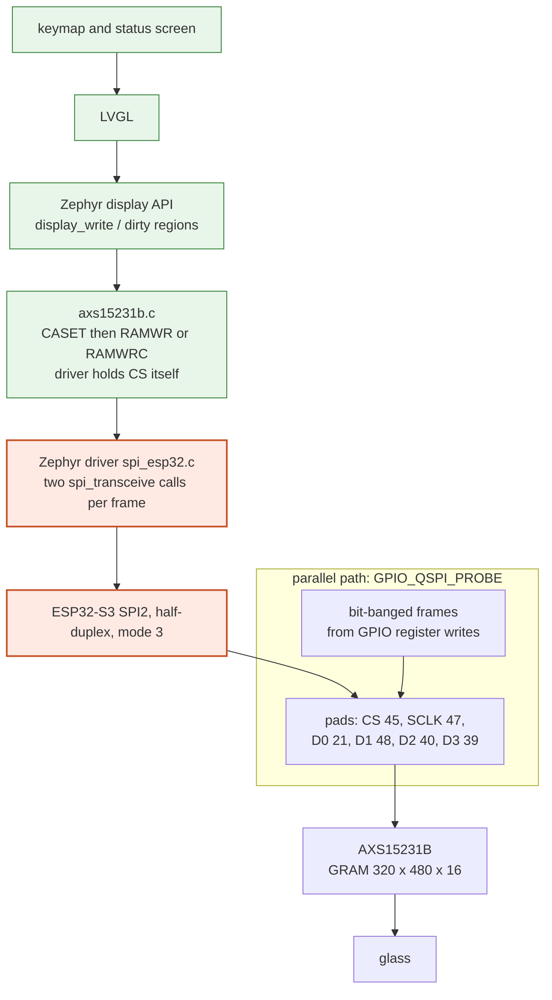
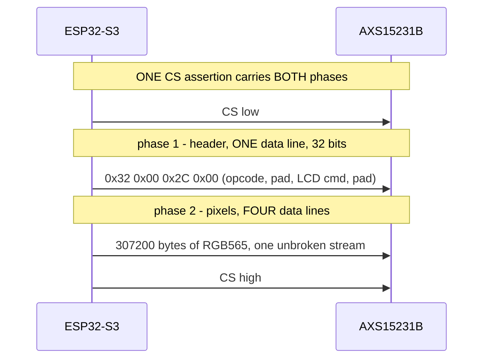
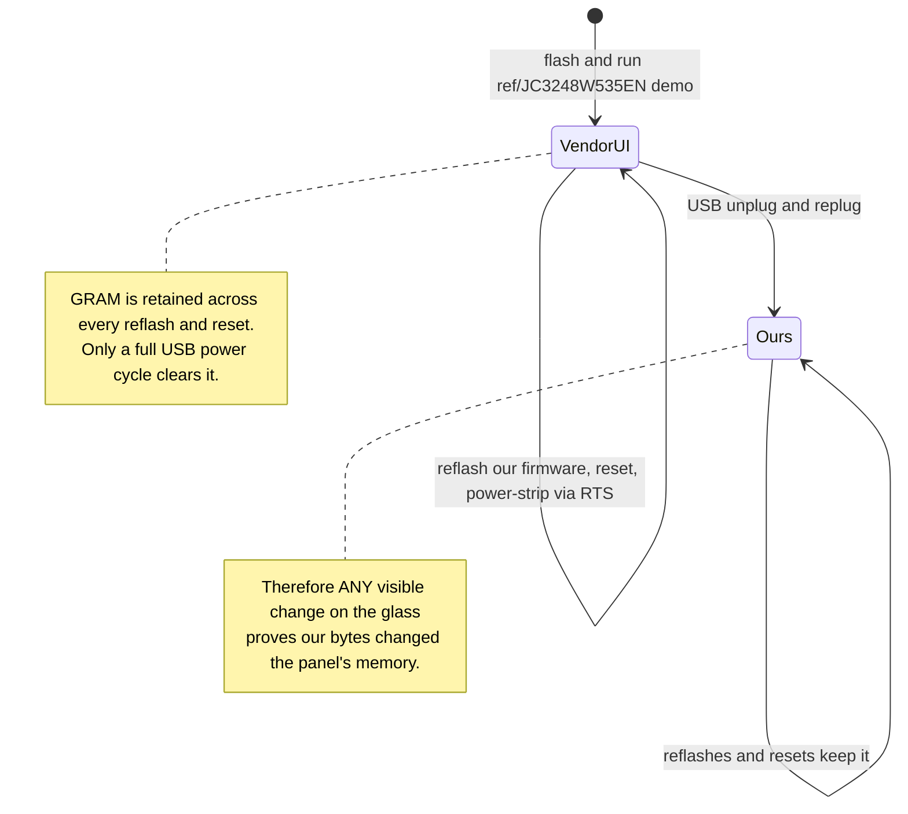
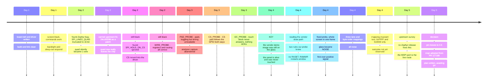
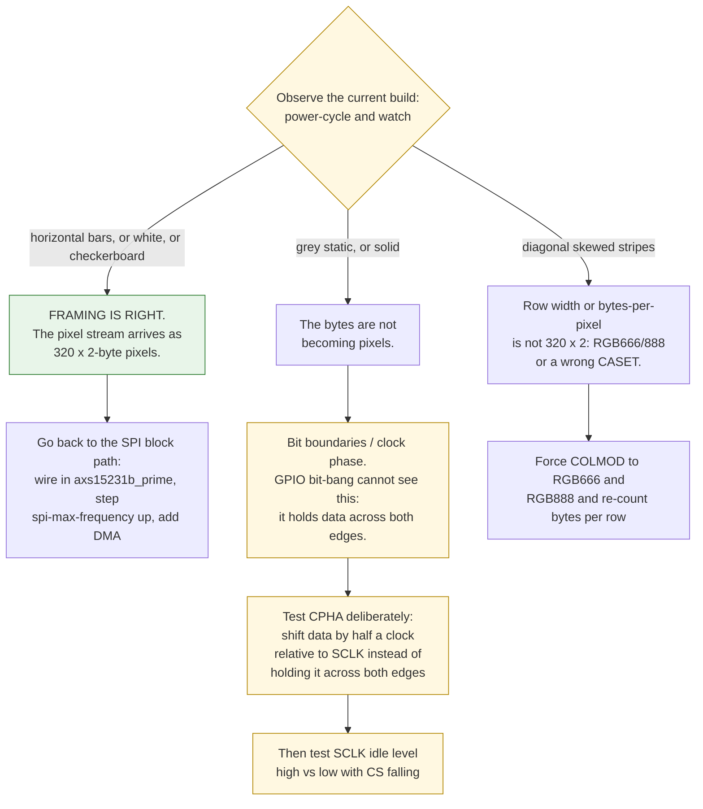
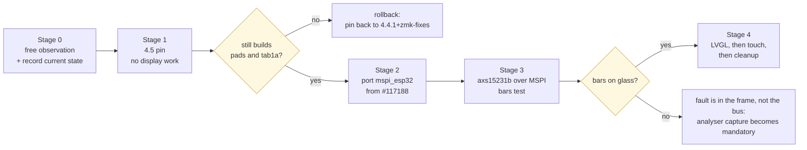

# AXS15231B on Coban Tab 1a — bring-up findings, dead ends, and what to do next

**Status:** the panel is *not* working. Display bring-up is blocked on one unknown.
**Direction decided 2026-11-18:** upgrade the Zephyr pin to **4.5**, and adopt the ESP32 **MSPI** controller from
PR #117188 instead of continuing to fight `spi_esp32_spim.c`. Plan with gates and rollbacks in
[§13](#13-plan-zephyr-45-upgrade--mspi-adoption) — **not implemented yet, awaiting confirmation.**
**Hardware:** Coban Tab 1a — ESP32‑S3 + JC3248W535EN module (AXS15231B controller, 320×480, QSPI, RGB565, capacitive touch on I²C).
**Written:** 2026-11-18, after ~4 days of hardware bring-up. Supersedes the notes scattered through `axs15231b.c` comments.
**Repos:** all work is **uncommitted** in `zmk/` and `zmk-config/` (see [State of the tree](#state-of-the-tree)).

> **TL;DR** — The vendor's own ESP-IDF demo paints a picture on this exact board and unit. Our firmware does not.
> Commands reach the controller (backlight, sleep-out, display-on/off are visible). Pixel data has never been
> turned into pixels by anything we built. The single strongest result so far: a hand-built QSPI pixel stream
> from GPIO **replaced the vendor demo's frozen image with noise** — the first time our firmware ever changed
> the panel's memory. Everything is now narrowed to one of: (a) Zephyr's ESP32 SPI block mis-renders quad
> transfers, or (b) the clock phase / bit-boundary conventions differ between us and the panel.

---

## 1. What "working" means

| Phase | Deliverable | State |
| --- | --- | --- |
| A | Panel initialises over QSPI, LVGL status screen (clock/calendar) visible | **blocked — this document is about this** |
| B | Backlight PWM (LEDC ch0 → GPIO1) on/off + idle blanking | works, verified visually |
| C | Touch over I²C 0x3B (SDA GPIO4, SCL GPIO8, 400 kHz) | not started; bus is silent, see [side issues](#7-side-issues-that-are-not-the-display) |
| D | RAM/PSRAM budget, FPS, current draw recorded in `esp-port/test-results/` | not started |

The whole screen pipeline downstream of the display driver is known-good: ZMK's shell + LVGL render fine on
other targets, and the driver compiles, links, and reports `AXS15231B initialized (320x480)` at ~0.53 s
in every boot log.

---

## 2. The system, and where the fault boundary is



**What is proven good:** everything above `SPI` in that picture, plus the pads and their routing, plus the
controller's power, GRAM and glass. **What is suspect:** the ESP32 SPI peripheral's quad rendering, and the
clock-phase convention at the pad.

The `GPIO_QSPI_PROBE` path exists precisely to bypass the suspect region: it drives the same six pads with
hand-written register writes and hand-built edges, so any difference in outcome can only belong to the SPI block.

---

## 3. The wire protocol (as verified, not as assumed)

Ground truth is the vendor driver `ref/JC3248W535EN/src/esp_lcd_axs15231b.c` plus ESP-IDF's
`esp_lcd_panel_io_spi.c`. Three rules of this panel in QSPI mode, each of which cost us a debugging day:



1. **The header is 32 bits on one line, the pixels are 4-wire.** `AXS15231B_PANEL_IO_QSPI_CONFIG` sets
   `quad_mode = true` and `lcd_cmd_bits = 32`; in IDF's `esp_lcd_panel_io_spi.c`, `quad_mode` sets
   `SPI_TRANS_MODE_QIO` **only on the color transfer** — the command/param transfers stay single-line
   (only `octal_mode` makes the command multiline). Opcode `0x02` = command+params on D0, `0x32` = pixels on
   four lines. Header byte order is `[opcode, 0x00, cmd, 0x00]` — confirmed twice, against IDF's
   `spi_lcd_prepare_cmd_buffer()` byte reversal and against the vendor's `(opcode << 24) | (cmd << 8)`.
2. **RASET is never sent in QSPI mode.** The vendor guards it: `if (0 == flags.use_qspi_interface)`. The panel
   takes its rows from the write command plus the number of pixels streamed. Our first driver sent RASET.
3. **`RAMWR` (0x2C) restarts the window; `RAMWRC` (0x3C) continues it.** The vendor picks by
   `if (y_start == 0) RAMWR else RAMWRC`. Consequence: a fill chopped into several frames, each issuing its
   own `RAMWR` under its own CS, **repaints the same first pixels forever** and never reaches the rest of the
   screen. Our earlier GPIO probe did exactly this, so its "nothing happened" result was worthless.

The panel wants **SPI mode 3** (`spi_mode = 3`, CPOL=1/CPHA=1, SCLK idles high) at **40 MHz**
(`.pclk_hz = 40 * 1000 * 1000`), with **DMA** (`SPI_DMA_CH_AUTO`) and `trans_queue_depth = 10`.
ESPHome drives this same controller family at `data_rate: 40MHz`.

**Our configuration today:** `spi-max-frequency = <1000000>`, half-duplex, no bus-level `cs-gpios` (CS moved
into the panel driver because Zephyr's ESP32 driver ignores `SPI_HOLD_ON_CS`), **no DMA** (`&spi2` has no
`dmas` property, so the driver's DMA path is unavailable and transfers are polled).

---

## 4. The single most useful property of this hardware



The panel retains its GRAM across reflashing and resets. So the vendor demo's LVGL image sits frozen on the
glass while our firmware runs, and we can tell with certainty whether our firmware touched the panel memory
at all. Every observation in this document rests on that, and every observation has to come from a human
looking at the glass — which is a large part of why this took so long.

---

## 5. Investigation timeline



---

## 6. Evidence ledger

Read this before designing any new experiment. Each row is a hypothesis that has already been paid for.

| # | Hypothesis / question | Method | Result | Verdict |
| --- | --- | --- | --- | --- |
| 1 | Wrong pin map | compared `ref/JC3248W535EN/src/esp_bsp.h` with our overlay | CS 45, PCLK 47, D0 21, D1 48, D2 40, D3 39, BL 1, RST **NC**, TE 38, SDA 4, SCL 8 | ruled out |
| 2 | Signals not routed out of the SPI block | `WIRE_PROBE`: read `uart_cam`/`spi_cam` pin-swap regs and the GPIO-matrix signal routing | all six pads carry the right peripheral signals | ruled out |
| 3 | Zephyr never really goes quad | registers + logic capture on the pads | **confirmed bug**: `spi_esp32_get_line_mode()` takes `uint16_t`, so `SPI_LINES_QUAD` (bit 16+) truncates to 0 → always 1-wire | **fixed**, carried as patch |
| 4 | CS raised between header and pixels | read `esp_lcd_panel_io_spi.c` (`SPI_TRANS_CS_KEEP_ACTIVE`) vs Zephyr | Zephyr's ESP32 driver never reads `SPI_HOLD_ON_CS` | **fixed**, CS driven by the panel driver, `AXS_NO_HW_CS_SLAVE 3` |
| 5 | Init table wrong | byte-compared our table against `esp_bsp.c lcd_init_cmds` | identical | ruled out |
| 6 | Header byte order wrong | read IDF `spi_lcd_prepare_cmd_buffer()` and vendor `tx_param()` | `02 00 cmd 00` is right | ruled out |
| 7 | Command phase must be 4-wire | read IDF `tx_param()`: multiline is set for `octal_mode` only | commands really are 1-wire | ruled out |
| 8 | Missing SWRESET, or wrong reset wiring | vendor `panel_axs15231b_reset()`; vendor RST is NC | SWRESET + 120 ms present, no reset line exists | ruled out |
| 9 | CS pad not actually moving | `CS_PROBE`: drive GPIO13 of `gpio1`, sample the pad | pad follows both directions | ruled out |
| 10 | Data pads not actually moving | `PAD_PROBE`, then `GPIO_QSPI_PROBE` pad self-check | drive high/low and read back from the pad register: `ok ok` on all six pads | ruled out |
| 11 | Clock not reaching the pin | sample SCLK from the pad while a hand clock runs | 96 samples, 12 transitions = the 25 kHz test clock | ruled out |
| 12 | Clock divider too slow / too fast | computed S3 half-duplex divider: `pre` ≤ 16 × `n` ≤ 64 | slowest reachable SCLK ≈ 78 kHz, so a requested "8 kHz" **never existed**; ~2 µs sampling jitter cannot resolve an 8–13 µs bit | analyser route abandoned |
| 13 | Pad conflicts (kscan, JTAG, flash) | checked every user of the six pads | kscan uses GPIO2/5 | ruled out |
| 14 | Panel dead / glass dead / GRAM dead | flashed `ref/JC3248W535EN` demo with `./flash.sh jc3248` | **LVGL UI appears and works**; log shows `send init commands success` | ruled out — **positive control** |
| 15 | Our firmware never reached GRAM | the demo image was still frozen on the glass after our runs | true for every build until the fixed probe | ruled out |
| 16 | Hand-built quad frames reach GRAM | fixed probe: one frame, one CS assertion, no RASET, 307200 B | **the glass changed** from the vendor UI to noise | **first positive result** |
| 17 | Wrong lane order / wrong intra-pixel bit order | three fills: D0=first bit, D0=last bit, D0=last bit + bytes exchanged | all three: noise | none of these mappings, inconclusive as a set (see §9) |
| 18 | Framing: does the stream decode as 320 × 2-byte pixels | three fills of `0xFFFF`/`0x0000` only (invariant to every intra-pixel permutation): white → checkerboard → 4-row bars | build flashed and ran (log confirms all three fills, ~0.56 s each); **the glass was never observed** | **OPEN — this is where we are** |
| 19 | I²C touch dead indicates the chip is half-dead | `I2C_PROBE`: bus clocks, address scan 0x08–0x77 | nothing ACKs | separate issue; vendor demo logs no touch errors either — the touch node in that demo is I²C at 0x3B and is also not proven |

### Fixed bugs, for the record

| Bug | Where | Fix |
| --- | --- | --- |
| `SPI_LINES_QUAD` silently downgraded to 1-wire | `zephyr/drivers/spi/spi_esp32.c` (`spi_esp32_get_line_mode()` parameter is `uint16_t`) | upstream `24cc93286`, carried in `zmk/esp-port/patches/0001-*.patch`, re-applied by `esp-port/apply-zephyr-patches.sh` from `setup-dev.sh` and `build_cobantab1a.sh`; idempotent, fails loudly on drift. Drop it when the Zephyr pin (v4.4.1+zmk-fixes) includes it. |
| `SPI_HOLD_ON_CS` ignored, CS raised mid-frame | `zephyr/drivers/spi/spi_esp32.c` | workaround in our driver: no `cs-gpios` on `&spi2`, `cs-gpios` on the `axs15231b` node, driver brackets both phases itself. Side effect: compiles out upstream's mode-3 "dummy transaction to sync CLK and software CS" workaround, which is why `axs15231b_prime()` exists. |

---

## 7. Side issues that are *not* the display

Do not chase these as causes of the black screen — they are independent. But they do affect any long test run.

- `flash_esp32: Flash write error: 261` (= `ESP_ERR_NOT_FOUND`) writing `storage` at `0xfb0000`, then
  `settings_subsys_init failed (err -5)`. Needs a partition-table / flash-size check.
- BLE controller assert `hci_core.c:482` at ~13.5 s **halts the board**, which is why
  `CONFIG_ZMK_BLE=n` is set temporarily. Long probe sequences were being cut off by this.
- `CONFIG_SYS_CLOCK_TICKS_PER_SEC=250000` is temporary (bring-up timer resolution) and must go back.
- Two older builds with `CONFIG_AXS15231B_PIXELS_1WIRE=y` produced **zero console bytes**. Unexplained,
  never investigated. Do not conclude anything from a build with that option on.
- Homebrew CMake 4 must not be used (rejects `cmake_minimum_required < 3.5`, e.g. `libmetal`);
  the pip wheel in `zmk/.venv` and `~/.local/bin` shims exist for this — see `zmk/esp-port/toolchain-esp32.md`.

---

## 8. What is running right now

`CONFIG_AXS15231B_GPIO_QSPI_PROBE=y` is the live probe; `COLOR_TEST`, `COMMAND_PROBE`, `QSPI_TOUCH_PROBE`,
`WIRE_PROBE`, `PAD_PROBE`, `I2C_PROBE`, `CS_PROBE` are all off. On boot the probe:

1. takes the six pads from SPI2 by direct register write (bank-aware `out1_*`/`enable1_*`/`in1` for pads ≥ 32,
   which is five of the six), enables input on each;
2. self-checks: drives every pad high then low and reads it back from the pad register, then samples SCLK from
   the pad while its own clock runs — this is what makes the rest of the run trustworthy;
3. sends `SWRESET` → `SLPOUT` → `COLMOD 0x55` → `CASET 0..319` → `DISPON`, all 1-wire, **no RASET**;
4. paints three full screens, one unbroken frame and one CS assertion each, ~0.56 s apiece (~550 kB/s), ~2.5 s
   apart: `0xFFFF` white → pixel-on/off checkerboard → 4-row light/dark bars.

Expected if framing is right: solid white, then grey checkerboard, then **horizontal 4-row bars, left on the
glass**. Power-cycling (USB unplug/replug) replays the whole sequence.

**The result of that run has not been observed.** That is the immediate next action — see §9.

One known code-hygiene wart from the last edit: the explanatory comment block for step 4 is stranded inside
`axs15231b_gpio_qspi_probe()` at the wrong indent level, and the function's header comment still describes the
older red/green/blue fills. Cosmetic only.

---

## 9. The two remaining hypotheses, and the experiments that tell them apart



### Ranked next experiments

1. **Look at the glass.** Free, and it splits the search space in half. (`./flash.sh tab1a` has already run;
   power-cycle to replay. Ask the user, or add it to the log script as a timed prompt.)
2. **Get a logic analyser that actually decodes.** Every failure so far was a *measurement* problem, not a
   reasoning problem. The earlier capture attempt failed because it sampled a 25 kHz-ish signal at ~2 µs
   jitter and tried to read intervals by hand — not because capture is useless. An 8-channel analyser at
   ≥ 24 MHz on CS/SCLK/D0–D3, with a SPI decoder attached, captures **the vendor demo's frames and our
   frames on the same board** and shows the difference directly: idle level of SCLK, which edge latches data,
   where the bit boundary falls after CS falls, and how many bits per pixel. One capture would replace about
   two days of the work recorded in §6. **This is the highest-value thing a human can do here.**
3. **Bisect from the working side, not the broken side.** The vendor demo is a known-good firmware on the same
   silicon. Modify it to do the *minimum* that could fail — replace its pixel fill with a solid colour, then
   replace its `esp_lcd_panel_io_spi` calls with raw `spi_master` half-duplex quad transfers configured the
   way Zephyr configures them. Each step that still paints eliminates a whole layer.
4. **The MSPI route** — see the next subsection for the port list. Zephyr issue
   [`#102333`](https://github.com/zephyrproject-rtos/zephyr/issues/102333) is the live thread (28 comments, still
   active as of 2026-11-16): every community port of an ESP32‑S3 QSPI LCD goes through the MSPI controller,
   because `spi_esp32_spim.c` was never built for quad LCD writes. The one comment that sums it up, from someone
   who got a 466×466 QSPI AMOLED running on upstream `chipone,co5300` + downstream MSPI: *"the CO5300 SPI backend
   is single-line. Quad writes require MSPI."*

### The chosen route: adopt the MSPI driver from PR #117188 (step-by-step in §13)

This is now the decided path. The analysis below is why, and §13 is the plan.

This is the path with the highest expected value, and **it does not require a Zephyr upgrade** — see the next
subsection. Our pinned v4.4.1 already has the MSPI *subsystem* (`zephyr/drivers/mspi/` with ambiq, dw and stm32
backends, and `dts/bindings/mspi/`); what is missing is only the ESP32 *backend*.

Copy from [`PR #117188`](https://github.com/zephyrproject-rtos/zephyr/pull/117188) (open, unmerged, last activity
2026-11-16), 6 files:

```
drivers/mspi/mspi_esp32.c                        +1559
drivers/mspi/mspi_esp32.h                          +90
drivers/mspi/Kconfig.esp32                          +54
drivers/mspi/Kconfig                                 +1
drivers/mspi/CMakeLists.txt                          +1
dts/bindings/mspi/espressif,esp32-mspi.yaml         +84
```

It **cannot be taken as-is**. The thread documents what is wrong with it and who fixed what:

| Take from | Why it is needed |
| --- | --- |
| **#121107** `drivers: mspi: esp32: fix status and devicetree integration` (open, updated 2026-11-18) | an MSPI-only build omits the SPI HAL sources → unresolved `spi_hal_*`; optional `dma-host` / polling-IRQ DT properties are read unconditionally. |
| **[`zephyrproject-rtos/hal_espressif#670`](https://github.com/zephyrproject-rtos/hal_espressif/pull/670)** | fixes that HAL source selection. We already fetch `hal_espressif` blobs, so this is a patch to a vendored module. |
| walidbadar's branch `mspi_esp32_review` @ `d715fdcbbac` | `get_channel_status()` (a mandatory op) and `MSPI_DEVICE_CONFIG_ALL` support, which the in-tree MSPI device drivers require; plus Kconfig correctness — `MSPI_ESP32_PSRAM_DMA` depends on `SOC_GDMA_SUPPORTED` / `SOC_PSRAM_DMA_CAPABLE`, which are ESP-IDF `soc_caps.h` macros and **not** Kconfig symbols, so they must become `ESP_SPIRAM` + an explicit SoC-series condition. |

The MSPI device-side pattern we would copy is **already merged upstream** — `drivers/display/display_co5300.c`
gained MSPI bus support in [`PR #117765`](https://github.com/zephyrproject-rtos/zephyr/pull/117765) (merged
2026-09-23, milestone **v4.5.0**). That means the layering the maintainers accepted for "DCS-ish panel over a
4-line bus" is public, and canpool's hardware-verified DT for a 466×466 ESP32‑S3 QSPI AMOLED (2026-11-14) is a
near-direct template for our node:

```dts
chunk-size = <4092>;                    /* NOT the 4096 default - see below */
mspi-max-frequency = <40000000>;
mspi-io-mode = "MSPI_IO_MODE_QUAD_1_1_4";   /* 1-line cmd, 1-line addr, 4-line data == our 0x02/0x32 framing */
pixel-format = <PANEL_PIXEL_FORMAT_RGB_565>;
red-blue-swap;                          /* RGB565 otherwise defaults to MIPI_DCS_ADDRESS_MODE_BGR */
```

Three traps stated explicitly by people who hit them:

1. **`chunk-size` 4096 silently truncates.** GDMA's `lldesc_t.length` is 12 bits, so one descriptor carries at
   most **4092** bytes; with 4096 the tail of every chunk is dropped and *the transfer still reports success* —
   "the panel shows a smeared partial frame". That failure mode looks exactly like our noise, and it applies the
   moment we put DMA anywhere near this panel on either bus.
2. **LVGL must be made to emit aligned dirty regions.** canpool needed
   `CONFIG_LV_Z_AREA_X_ALIGNMENT_WIDTH=2` and `=2` for Y (even column/row addresses). **This lever already
   exists in our pin** — `config LV_Z_AREA_X_ALIGNMENT_WIDTH` at `zephyr/modules/lvgl/Kconfig:132`, default 1,
   power-of-two required. If it ever is not enough, walidbadar's `LV_EVENT_INVALIDATE_AREA` rounder is posted in
   #102333 as a fallback.
3. **TE can hang the first flush**: the merged co5300 path waits `k_sem_take(K_FOREVER)` on a semaphore starting
   at 0, so an unwired or missed TE pulse deadlocks with no diagnostic. We do not use TE; do not inherit this.

Performance reference point from the MSPI author: ~12 FPS at full-screen refresh, later ~30 FPS (~40 idle) on a
466×466 panel — so our 320×480 has headroom.

### Would upgrading to Zephyr 4.5 help? → decided: **yes, we upgrade** (2026-11-18)

**Decision recorded:** move the pin from `v4.4.1+zmk-fixes` to a `v4.5.0`-based pin, and adopt the ESP32 MSPI
controller from PR #117188 on top of it. Plan in [§13](#13-plan-zephyr-45-upgrade--mspi-adoption).

**One correction to what this document said earlier.** I first wrote that a 4.5 move was "a fork-rebase project
of its own". That was wrong, and it was wrong in the direction that argued against upgrading. Checked against
the fork: `compare/v4.4.1...v4.4.1+zmk-fixes` is **409 commits ahead**, but essentially all 409 are upstream
`v4.4-branch` content (the 4.4.2 release and its backports). The genuinely local delta is **two commits**, both
by ryandam on 2026-09-30:

| Commit | Files | Net effect |
| --- | --- | --- |
| `75d4e3c07` *Prepare for debuging* | `drivers/usb/udc/udc_nrf.c` +18, `subsys/usb/device_next/class/usbd_cdc_acm.c` +67/−12 | |
| `8789b58bc` *Fix USB + remove log* | `drivers/usb/udc/udc_nrf.c` −18, `subsys/usb/device_next/class/usbd_cdc_acm.c` +20/−5 | `udc_nrf.c` cancels out exactly |

So the whole fork delta reduces to **one net file, `usbd_cdc_acm.c`** — a USB CDC-ACM change that matters to the
CobanPad builds over USB and is **not on the ESP32-S3 display path at all**. Upgrading is cheap; my earlier cost
estimate was based on the 409 number without reading what they were.

**What 4.5 genuinely buys us:**

- `drivers/display/display_co5300.c` gains MSPI bus support + `chunk-size` (PR #117765, merged, milestone
  v4.5.0) — the merged, maintainer-approved device-side template for "DCS-ish panel on a 4-line bus", which is
  the shape of our driver.
- A newer `include/zephyr/drivers/mspi.h` (877 → 969 lines) and an MSPI core with more of the ops #117188
  expects, which lowers the porting risk of the copy.
- The carried quad-line-mode patch becomes deletable (`24cc93286` is an ancestor of v4.5.0), and our patched
  line at `spi_esp32_spim.c:502` already reads the same as 4.5.0's.

**What 4.5 does *not* buy us — unchanged, verified by fetching the file at each tag:**

| Thing we need | v4.4.1 (ours) | v4.5.0 | main | Verdict |
| --- | --- | --- | --- | --- |
| `SPI_LINES_QUAD` not truncated | ✗ `get_line_mode(uint16_t)` | ✓ `get_line_mode(spi_operation_t)` | ✓ | we already carry the equivalent fix |
| ESP32 MSPI backend (`drivers/mspi/mspi_esp32.c`) | ✗ | ✗ | ✗ | **absent in every release** — this is why the port is on us |
| MSPI subsystem to host it | ✓ (ambiq, dw, stm32) | ✓ | ✓ | 4.5 is not *required* for the port, only helpful |
| `SPI_HOLD_ON_CS` honoured by the ESP32 SPI driver | ✗ | ✗ | ✗ | unfixed everywhere → driver-held CS survives the upgrade |
| mode-3 "dummy transaction" workaround present | ✓ | ✓ | ✓ | `axs15231b_prime()`'s reasoning stays relevant |
| `CONFIG_LV_Z_AREA_X/Y_ALIGNMENT_WIDTH` | ✓ `modules/lvgl/Kconfig:132` | ✓ | ✓ | available before and after |

**The upgrade fixes nothing about the black screen by itself.** It is groundwork: a supported base, the merged
device-side template, and a smaller diff to carry once #117188 lands upstream.

### Deliberately held back

`axs15231b_prime()` (spend the first malformed mode-3 clock edge with CS raised, mirroring upstream's
`spi_esp32_configure` dummy-transaction workaround, which `DT_SPI_CTX_HAS_NO_CS_GPIOS` compiles out for us)
is **written but not called**, so that the GPIO experiment stays pure. It currently emits
`warning: 'axs15231b_prime' defined but not used`. It is the *second* variable to try, not the first — a
one-bit phase slip is a genuinely plausible explanation for "noise", and the theory is written up in the
comment at `axs15231b.c:143`.

---

## 10. Prior work to reference

### In this workspace

| Path | Why it matters |
| --- | --- |
| `ref/JC3248W535EN/src/esp_lcd_axs15231b.c` | **The positive control's driver.** `tx_param`/`tx_color` build `(0x02<<24)|(cmd<<8)`; `panel_axs15231b_draw_bitmap()` is the authoritative write path (no RASET in QSPI, RAMWR vs RAMWRC by `y_start == 0`); `panel_axs15231b_reset()` = SWRESET + 120 ms. |
| `ref/JC3248W535EN/src/esp_bsp.h` | **The authoritative pin map** and `BSP_I2C_CLK_SPEED_HZ 400000`. |
| `ref/JC3248W535EN/src/esp_bsp.c` | The 40-line `lcd_init_cmds` table we copied verbatim, and the panel-IO + panel construction (`use_qspi_interface = 1`, `rgb_ele_order RGB`, `bits_per_pixel 16`). |
| `ref/JC3248W535EN/src/esp_lcd_axs15231b.h:144` | `AXS15231B_PANEL_IO_QSPI_CONFIG` — `spi_mode = 3`, `pclk_hz = 40 MHz`, `lcd_cmd_bits = 32`, `lcd_param_bits = 8`, `quad_mode = true`, `trans_queue_depth = 10`. |
| `/Users/ryan/.platformio/packages/framework-espidf/components/esp_lcd/src/esp_lcd_panel_io_spi.c` | Exactly how IDF puts a 32-bit header on one line and color on four: `SPI_TRANS_CS_KEEP_ACTIVE` on the header, `SPI_TRANS_MODE_QIO` on the color chunks only (`quad_mode` → line ~385), `spi_lcd_prepare_cmd_buffer()` byte reversal. |
| `zmk/app/module/drivers/display/axs15231b.c` | Our driver: the good parts (`axs15231b_write` does CASET-only and RAMWR-vs-RAMWRC correctly, CS handled in-driver, backlight) and ~1000 lines of retired probes. |
| `zmk/app/module/drivers/display/Kconfig.axs15231b` | The probe switches: `COLOR_TEST`, `PIXELS_1WIRE`, `WIRE_PROBE`, `PAD_PROBE`, `I2C_PROBE`, `CS_PROBE`, `GPIO_QSPI_PROBE`, `COMMAND_PROBE`, `QSPI_TOUCH_PROBE`. All of these except `AXS15231B` are temporary. |
| `zmk-config/boards/shields/cobantab1a/cobantab1a.conf` | Which probe is live and why, in prose, plus the temporary `CONFIG_SYS_CLOCK_TICKS_PER_SEC=250000` and `CONFIG_ZMK_BLE=n`. |
| `zmk-config/boards/shields/cobantab1a/cobantab1a.overlay` | `&spi2` pinctrl (CLK 47, D0 21, D1 48, D2 40, D3 39 — note D1 also needs `FSPIQ_IN` for reads), `half-duplex`, deliberately no bus `cs-gpios`; `axs15231b@0` `cs-gpios = <&gpio1 13 …>`, `spi-max-frequency = <1000000>` with a TODO to go to 40 MHz; `&i2c0` on GPIO4/GPIO8 with `axs15231b_touch` enabled. |
| `zmk/esp-port/patches/` + `apply-zephyr-patches.sh` | The carried Zephyr quad fix and its verification checksum. |
| `zmk/backlogs/b05-cobantab1a-display-module.md` | The backlog item, with the original plan and phase table. Should get a link to this document. |
| `zmk/app/module/drivers/input/axs15231b_touch.c` | The touch driver, written against I²C — currently unproven because the panel has never displayed anything. |

### Upstream Zephyr: the full register (checked 2026-11-18 against the GitHub API)

Every thread found by searching Zephyr for `spi_esp32`, `esp32 quad spi lcd`, `axs15231b`, `MSPI`,
`SPI_HOLD_ON_CS` and `esp32 spi line mode`:

| Thread | State | What it gives us |
| --- | --- | --- |
| [`#102333`](https://github.com/zephyrproject-rtos/zephyr/issues/102333) *How to support QSPI LCD with ESP32* | **open**, 28 comments, active 2026-11-16 | The live thread for exactly our class of problem. Contains the working DT template, the 4092 trap, the LVGL alignment answer, the pinctrl confirmation, and pointers to three working third-party implementations. Start here. |
| [`#117188`](https://github.com/zephyrproject-rtos/zephyr/pull/117188) *drivers: mspi: ESP32 MSPI Driver* | **open**, unmerged, 6 files, last activity 2026-11-15 | The ESP32 quad bus we would port. Author has no time to land the review fixes and explicitly invites someone to assemble them. |
| [`#121107`](https://github.com/zephyrproject-rtos/zephyr/pull/121107) *drivers: mspi: esp32: fix status and devicetree integration* | open, updated 2026-11-18 | Required follow-up on #117188: HAL sources missing in MSPI-only builds, unconditional reads of optional DT props. |
| [`hal_espressif#670`](https://github.com/zephyrproject-rtos/hal_espressif/pull/670) | open | The HAL-side half of the above. |
| [`#117765`](https://github.com/zephyrproject-rtos/zephyr/pull/117765) *drivers: display: co5300: add support for mspi and spi bus* | **MERGED** 2026-09-23, milestone **v4.5.0** | The accepted device-side layering for a DCS-ish panel on a 4-line MSPI bus, incl. `chunk-size`. Not in our pin. |
| [`#115966`](https://github.com/zephyrproject-rtos/zephyr/pull/115966) *Driver: Adding the axs15231b lcd driver* | closed, **not merged**, stale, `block: HW Test` | **Someone else upstreamed this same controller** — 276 lines, binding `axstechnology,axs15231b.yaml`. But it is a plain `mipi_dbi` 4-wire SPI driver (`mipi_dbi_command_write(…, 0x2C, …)`): **no 32-bit QSPI opcode header**, so it does not solve our problem. Still worth reading for the init table and the `MADCTL BGR = BIT(3)` handling. Our binding name (`axs,axs15231b`) differs from theirs — worth matching if we ever upstream. |
| [`#110412`](https://github.com/zephyrproject-rtos/zephyr/issues/110412) *RFC: Native QSPI/QPI display transport for DCS-compatible panels* | closed (stale), 8 comments | The design discussion for what we are hand-rolling: names CO5300 / RM690B0 / SH8601A as the panel class, argues for a generic transport abstraction, points at #107529 as "the viable option", and links an OpenSiFli downstream MVP. Nobody landed it. |
| [`#107529`](https://github.com/zephyrproject-rtos/zephyr/pull/107529) *drivers: display: add driver for SH8501A controller over MSPI* | closed, not merged | The attempt the RFC pointed at. Prior art for panel-over-MSPI structure. |
| [`#94140`](https://github.com/zephyrproject-rtos/zephyr/pull/94140) *drivers: mspi: ESP32 MSPI Driver* | closed 2025, not merged | The first MSPI attempt; #117188 is its rewrite. |
| `24cc93286` *(commit)* drivers: spi: esp32: fix quad line mode truncated to 16-bit | **in v4.5.0 and main**, not in our pin | The bug we carry. Confirmed by tag comparison: `compare/v4.5.0...24cc93286` → `behind`/`ahead_by: 0`, i.e. the commit is an ancestor of v4.5.0. |
| [`#119918`](https://github.com/zephyrproject-rtos/zephyr/issues/119918) *NXP: support for half-duplex SPI (`SPI_HALF_DUPLEX`)* | open | Not ours, but the size of the hole: `SPI_HALF_DUPLEX` / `SPI_HOLD_ON_CS` semantics are still only partially honoured across drivers, ESP32 included. |

**Independent confirmation of two of our decisions**, from people who got QSPI AMOLED panels working on ESP32‑S3
in Zephyr (#102333, 2026-10-02 and 2026-11-14, both "hardware-verified"):

- the D1 lane needs both directions in the pinmux — `ESP32_PINMUX(n, ESP_FSPIQ_IN, ESP_FSPIQ_OUT)`, not
  input-only MISO — *"This restored grayscale/color ramps at 40 MHz"*. Our overlay already does exactly this for
  GPIO48, now corroborated twice.
- quad panels need `mspi-io-mode = "MSPI_IO_MODE_QUAD_1_1_4"`, i.e. 1-line command / 1-line address / 4-line
  data — the same 1-1-4 convention as our `0x02`-then-`0x32` framing.

### Community implementations outside Zephyr

| Repo | Why |
| --- | --- |
| [`EerieLeap/rt_gauge`](https://github.com/EerieLeap/rt_gauge/) | A full working ESP32‑S3 QSPI AMOLED bring-up in Zephyr: display + touch + a Multi-SPI driver rewritten for Zephyr's DMA driver (v4.4-compatible). Its `drivers/display/display_elco5300.h` and `DisplayInvalidateCb` in `ui_renderer_service.cpp` are the two files named in-thread as the fix for smeared/partial frames. |
| [`canpool/pony_zephyr`](https://github.com/canpool/pony_zephyr/commit/3524ddf76f94a1dc15b7d9024c02cf9cec40c606) | The port of the above to CO5300 with `PANEL_PIXEL_FORMAT_RGB_565`; screenshots show it working. |
| [`AmbiqMicro/ambiqzephyr`](https://github.com/AmbiqMicro/ambiqzephyr/blob/ambiq-stable/drivers/display/display_co5300.c) | An out-of-tree `display_co5300.c` with a QSPI/SPI backend (`ap510_disp_spi.overlay`) — a second device-side reference. |
| [`OpenSiFli/zephyr-downstream` @ `7c31bd5`](https://github.com/OpenSiFli/zephyr-downstream/commit/7c31bd523fd9effd599e573da1258e5a01d86755) | The RFC author's MVP for QSPI/QPI display transport (vendor-LCDC-backed; a layering reference, not a backend we can use). |
| [ESPHome `qspi_dbi`](https://esphome.io/components/display/qspi_dbi/) | Drives this controller family; note `data_rate: 40MHz` and explicit `cs_pin` / `reset_pin` handling. |
| [`waveshareteam/ESP32-S3-Touch-AMOLED-2.16#10`](https://github.com/waveshareteam/ESP32-S3-Touch-AMOLED-2.16/issues/10) | Same vendor family, panel-config ambiguities (offsets, `MADCTL`, startup delays) — the pattern of vendor-BSP-vs-generic-driver mismatch we hit too. |
| Stack Overflow: *"Issue initializing AXS15231B LCD via QSPI on ESP32‑S3 with ESP‑IDF v5.5.2"* | Almost certainly the same board and symptom. Not readable by fetch (403); open it in a browser. |

---

## 11. State of the tree

Nothing is committed in either repo. `git diff --stat`:

```
zmk:         Kconfig.axs15231b +121, axs15231b.c +1788/-325,
             axs,axs15231b.yaml +12, build_cobantab1a.sh +5
             untracked: esp-port/apply-zephyr-patches.sh, esp-port/patches/
zmk-config:  cobantab1a.conf +121, cobantab1a.overlay +41
```

Plus a **carried, uncommitted patch inside the gitignored west checkout**,
`zephyr/drivers/spi/spi_esp32_spim.c`, which `west update` will destroy — re-apply with
`bash esp-port/apply-zephyr-patches.sh` (automatic from `setup-dev.sh` and `build_cobantab1a.sh`).

**Verified, do not re-litigate:** the fix is genuinely in place. `spi_esp32_get_line_mode()` reads
`spi_operation_t operation` at `spi_esp32_spim.c:502`, byte-equivalent in effect to upstream v4.5.0's line.

**Two artifacts to clean up** (found 2026-11-18, both left by `patch(1)` in the west tree):

- `spi_esp32_spim.c.orig` and `spi_esp32_spim.c.rej` sit next to the patched file.
- The `.rej` is real but harmless: our patch file contains **two hunks for the same one-line change**, at
  `@@ -502` and at `@@ -732`. The first applies; the second can never match and is rejected every run. So the
  applier is correct today **and noisy by design** — a future maintainer reading a `.rej` cannot tell whether
  the fix landed. Collapse the patch to one hunk and delete the artifacts.

### Ops runbook

```sh
./build.sh tab1a                     # -> zmk/build/cobantab1a/zephyr/zmk.bin
./flash.sh tab1a                     # flash our firmware, then reset
./flash.sh jc3248                    # the positive control (vendor ESP-IDF demo)
python3 <tmp>/tab1a_log.py 25        # reset + capture from the ROM banner
```

Device `/dev/cu.usbmodem834401`. `tab1a_log.py` opens the port **before** the RTS→EN reset so the ROM banner is
always present; captured logs land in `tab1a-boot.log`. **Power-cycling the board (unplug/replug USB) is the
only thing that clears the panel's GRAM.**

### Known-good boot signature

`AXS15231B initialized (320x480)` at ~0.53 s → `gpio qspi:` pad checks all `ok ok` → SCLK sample line with 12
transitions → three fills at ~1.4 s, ~4.4 s, ~7.5 s → `gpio qspi: done`.

### Cleanup checklist before this can be merged

- [ ] Remove `COLOR_TEST`, `COMMAND_PROBE`, `QSPI_TOUCH_PROBE`, `WIRE_PROBE`, `PAD_PROBE`, `I2C_PROBE`, `CS_PROBE`, `GPIO_QSPI_PROBE`, `PIXELS_1WIRE`, `color_test_hold`, and their Kconfig entries and `.conf` prose.
- [ ] Restore `CONFIG_SYS_CLOCK_TICKS_PER_SEC` (drop the 250000 override) and `CONFIG_ZMK_BLE=y`.
- [ ] Raise `spi-max-frequency` toward 40000000 and decide DMA: `CONFIG_DMA=y` + `dmas` on `&spi2`, GDMA descriptors **4092** bytes.
- [ ] Fix or drop `axs15231b_prime()` (currently an unused-function warning).
- [ ] Collapse `esp-port/patches/0001-*.patch` to a single hunk and delete `spi_esp32_spim.c.orig` / `.rej` from the west tree.
- [ ] If the MSPI port happens: keep it as a numbered patch under `esp-port/patches/` with a header naming #117188 + #121107 + hal_espressif#670 as its provenance, so the day it merges upstream, the deletion is mechanical.
- [ ] Try `CONFIG_LV_Z_AREA_X_ALIGNMENT_WIDTH=2` / `_Y_=2` if dirty-region flushes ever come out smeared or shifted (available in our pin).
- [ ] LVGL pixel format: `PIXEL_FORMAT_RGB_565X` does **not** exist in this Zephyr/LVGL — byte order must be settled in the driver or the flush, not assumed.
- [ ] Fix the stranded comment block in `axs15231b_gpio_qspi_probe()` if the probe survives another round.
- [ ] Record RAM/PSRAM, FPS and current draw in `esp-port/test-results/`, and update `backlogs/b05-cobantab1a-display-module.md`.

---

## 12. Honest process notes — why this looped

Stated plainly, so the next person does not repeat it:

1. **The observation channel is a human eyeball, once per experiment.** Four days produced maybe a dozen
   observations. Any plan that needs more observations than that is the wrong plan; a logic analyser turns
   one capture into dozens of facts.
2. **Most probes measured instead of discriminating.** "Are the pads moving?" was answered yes, twice, and
   advanced nothing. Only experiments with two hypotheses and two different answers move the needle. The
   `0xFFFF`/`0x0000`-only fills were the first probe designed to be immune to an unknown variable — that is
   the pattern to copy.
3. **Three separate dead ends were caused by an unstated rule from the reference driver** (quad-truncated
   Zephyr bug, `SPI_HOLD_ON_CS`, and then RASET + `RAMWR`-restarts-window). **Read the reference implementation
   top to bottom before writing any probe against it.** Had `panel_axs15231b_draw_bitmap()` been read on day one,
   roughly two days go away.
4. **A negative result from a probe that is itself broken is worse than no result** — it retires good
   hypotheses. Two full probe rounds were built on the wrong frame structure. Every probe now self-checks
   first (pad readback, clock sampled from the pad); keep that discipline.
5. **The positive control should have been the first thing flashed, not the last.** `./flash.sh jc3248`
   on day one would have moved the entire search from "is the hardware alive?" to "what differs between two
   firmwares?", which is a tractable question.
6. **One conclusion in this document was wrong, and wrong in a way that argued against the right action.** I
   wrote that a Zephyr 4.5 move was "a fork-rebase project of its own", reading `409 commits ahead` off a
   `git compare` without opening the list. Those 409 are upstream `v4.4-branch` content; the actual local delta
   is two commits, net one file, on a path the ESP build never touches. A number that was cheap to quote and
   expensive to believe. Every quantitative claim here that came from a tool has since been re-opened and read;
   treat anything that has not been as unverified.

---

## 13. Plan: Zephyr 4.5 upgrade + MSPI adoption

**Status: awaiting confirmation — nothing below is implemented yet.** Two independent workstreams, each with its
own rollback. Nothing is committed at any point, per the repo workflow.



### Stage 0 — before touching anything (~30 min, no code)

1. Record the observation that is still outstanding: power-cycle the current build and note what the glass shows
   (bars / skew / static / solid). It is the only measurement that says whether the SPI path is worth keeping as
   a fallback at all.
2. Snapshot the uncommitted state so any of this can be discarded cleanly: `git -C zmk diff` and
   `git -C zmk-config diff` into the temp folder. The west tree is recreated by `west update`, so nothing of
   value lives there beyond `esp-port/patches/`, which is already in git.
3. Build the `native_sim` tests today, so that a later failure can be attributed to the pin rather than to
   pre-existing breakage.

### Stage 1 — the pin move

| Step | Action |
| --- | --- |
| 1.1 | In `RyanDam/zephyr`: create `v4.5.0+coban-fixes` from upstream `v4.5.0` and cherry-pick the net local change. **This is the one step that needs a push, so it is yours to run** — commands below. |
| 1.2 | `app/west.yml`: bump `revision:` from `v4.4.1+zmk-fixes` to `v4.5.0+coban-fixes`. |
| 1.3 | `west update` — resets `zephyr/` and `modules/`; any dirty file there is lost by design. |
| 1.4 | **Delete** `esp-port/patches/0001-spi-esp32-*` and its `.verify`: 4.5 already contains the fix, so applying it would be wrong. Teach `apply-zephyr-patches.sh` to fail loudly if a deleted patch reappears. |
| 1.5 | Re-check `esp-port/toolchain-esp32.md`: CMake 3.x and `ESPRESSIF_TOOLCHAIN_PATH` still apply; the SDK version is read from `zephyr/SDK_VERSION` either way. |

```sh
# 1.1 — yours to run, it pushes to your fork
git -C zmk/zephyr fetch upstream tag v4.5.0
git -C zmk/zephyr switch -c v4.5.0+coban-fixes v4.5.0
git -C zmk/zephyr cherry-pick 75d4e3c07 8789b58bc   # udc_nrf.c cancels out; net = usbd_cdc_acm.c
git -C zmk/zephyr push -u origin v4.5.0+coban-fixes
```

**Gate:** `./build.sh pad12b` and `./build.sh tab1a` both succeed, and a CobanPad still enumerates over USB —
that is what the carried `usbd_cdc_acm.c` delta protects. Rollback is a one-line revert in `app/west.yml`.

**Risks accepted:** nobody here has built ZMK's app tree against 4.5; LVGL is newer there and ZMK's `LV_Z_*`
usage may need adjusting; and the `hal_espressif` module version moves with the manifest, which can change the
blob requirements of the ESP build (`west blobs fetch hal_espressif`).

### Stage 2 — the MSPI controller from #117188

Carried the same way patch 0001 was carried: a numbered patch under `esp-port/patches/` with provenance in its
header, re-applied by `apply-zephyr-patches.sh` from `setup-dev.sh` and `build_cobantab1a.sh`, idempotent and
loud on drift, so that deleting it is mechanical the day #117188 merges.

| Patch | Source | Content |
| --- | --- | --- |
| `0002-mspi-esp32.patch` | [#117188](https://github.com/zephyrproject-rtos/zephyr/pull/117188) | `drivers/mspi/mspi_esp32.c` +1559, `.h` +90, `Kconfig.esp32` +54, `Kconfig` +1, `CMakeLists.txt` +1, `dts/bindings/mspi/espressif,esp32-mspi.yaml` +84 |
| `0003-mspi-esp32-fixes.patch` | [#121107](https://github.com/zephyrproject-rtos/zephyr/pull/121107) + walidbadar's `mspi_esp32_review@d715fdcbbac` | DT status and the unconditionally-read `dma-host` / polling-IRQ properties; `get_channel_status()` and `MSPI_DEVICE_CONFIG_ALL`; Kconfig deps written with ESP-IDF `soc_caps.h` macros that are not Kconfig symbols |
| `0004-hal-espressif-mspi.patch` | [hal_espressif#670](https://github.com/zephyrproject-rtos/hal_espressif/pull/670) | SPI HAL source selection — without it an MSPI-only build has unresolved `spi_hal_*` |

`apply-zephyr-patches.sh` has to be extended to patch **`modules/hal/espressif`** as well as `zephyr`; it only
knows about `zephyr` today.

**Gate:** a build with `CONFIG_MSPI=y` and an MSPI bus node that merely *initialises* — logs a channel status —
is enough to call Stage 2 done. No panel code yet.

### Stage 3 — the panel over MSPI

New `CONFIG_AXS15231B_BUS_MSPI`, with the SPI path kept compilable until the MSPI path is proven.

- **Device tree:** replace the `&spi2` pinctrl block with an MSPI bus node plus the panel as its child, carrying
  the values the community verified on hardware — `chunk-size = <4092>`, `mspi-max-frequency = <40000000>`,
  `mspi-io-mode = "MSPI_IO_MODE_QUAD_1_1_4"`.
- **Driver:** `axs15231b_write()` and the frame helpers gain an MSPI branch built on `mspi_transfer`, where
  opcode/addr/cmd line counts and `io_mode` express the 32-bit header natively — the one thing
  `spi_esp32_spim.c` cannot do. CS returns to the bus node only if MSPI is shown to hold it across phases;
  otherwise the driver keeps holding it, as it does today.
- **First test is not LVGL:** paint the same mapping-invariant fills the GPIO probe uses today — `0xFFFF` white →
  checkerboard → 4-row bars. Same question, same answer set, now on the bus we intend to ship.
- **Then** LVGL, then byte order (`red-blue-swap` / `MADCTL` BGR: RGB565 defaults to
  `MIPI_DCS_ADDRESS_MODE_BGR` while this panel's BSP uses 0x00), then `CONFIG_LV_Z_AREA_X_ALIGNMENT_WIDTH=2` if
  flushes smear.

**Gate:** 4-row bars, then the LVGL status screen. If bars still do not appear on a bus the community has
proven, the fault is the frame content and not the transport — and then the logic-analyser capture of
vendor-demo-vs-ours stops being optional and becomes the only way forward.

### What this plan deliberately does not do

It does not retire the SPI path yet, does not start touch (I²C 0x3B has still never ACKed), and does not fix the
`storage` partition `ESP_ERR_NOT_FOUND` or the BLE `hci_core.c:482` assert. Those stay listed in §7, and must be
re-tested after the pin move, because 4.5 changes both the flash driver and the Bluetooth controller.
